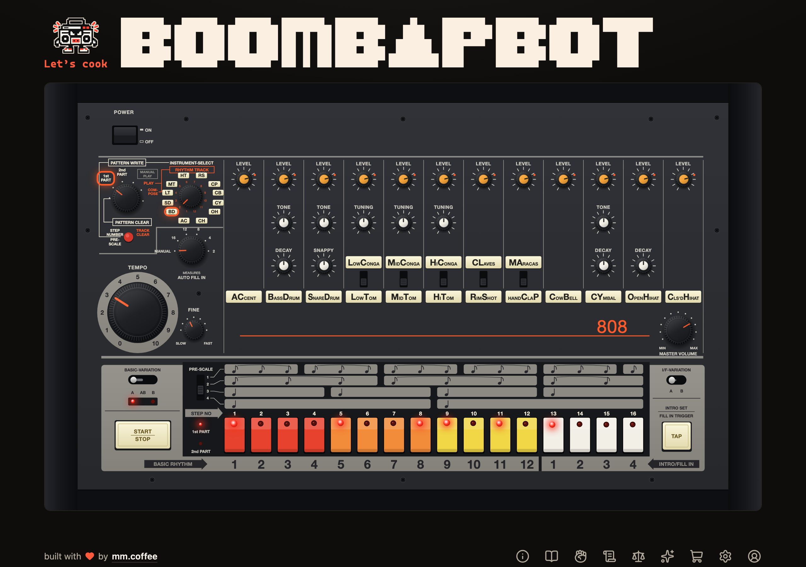

# boombapbot

A drums-only beat maker. This is **v0.1**: the web editor, running entirely on
your machine with no accounts, secrets or external services.



Open the editor and the page is a drum machine. Press its start button and you
hear a beat; toggle steps and turn the tempo knob on the faceplate. Everything
else is behind the cog in the footer: change swing, move to a grid of every
lane at once, and export the beat as WAV, MIDI or a project file. Reload and
your beat is still there.

The 808 panel above is original artwork, drawn in code by
[`scripts/draw-faceplates.mjs`](scripts/draw-faceplates.mjs).

## Run it

You need Node 22.23.4 (`.nvmrc`), pnpm 10.28.0 (`corepack enable` provides
it), CMake 3.22 or newer, Ninja, a C++20 compiler, Python 3 and git.

```bash
./scripts/setup-emsdk.sh
```

```bash
pnpm install
```

```bash
pnpm build:engine
```

```bash
pnpm build:wasm
```

```bash
pnpm dev
```

Then open http://localhost:4321.

- `setup-emsdk.sh` installs Emscripten 6.0.13 (pinned in `.emscripten-version`)
  into `.tools/emsdk`. It is needed once and touches nothing outside the repo.
- `build:engine` builds the native C++ core and runs its tests. `build:wasm`
  builds the same sources to WebAssembly.
- No environment variables are read. The site makes no network requests
  beyond its own files.

To try the production build instead:

```bash
pnpm build
```

```bash
pnpm serve
```

## What v0.1 does

- **A page that is just the machine.** The mascot and wordmark, the drum
  machine, and a footer with a cog. The cog opens a settings sheet holding
  the beat name, tempo (40 to 240 BPM), swing (50 to 75%), the choice of
  editor, undo and redo, a starter beat, a clear action, import and export,
  and the save and audio status.
- **Hardware editor (prototype).** What the page opens on: the 808 panel,
  with step buttons, instrument selector, start/stop and tempo knob on the
  faceplate. The tone, decay, tuning and snappy knobs of the bass drum,
  snare, low and high tom, cymbal and open hi-hat turn, and each one
  re-synthesises its own sound as it moves. See
  [Hardware mode](#hardware-mode-and-faceplates).
- **Modern editor.** Chosen in settings, and editing the same beat: eight
  lanes by 16 steps in 4/4, play and stop, per-step velocity and voice
  audition pads. Works with mouse, keyboard and touch; on a phone each lane
  wraps into two rows of eight.
- **The 808, for now.** The page offers one kit and has no kit picker. Kits
  and panels for the 606, 707 and 909 are in the repository and still tested,
  but held back until the 808 is finished;
  `packages/contracts/data/offered-kits.json` lists what the page offers. All
  four kits are synthesised placeholders, not recordings of hardware. See
  [Demo kits](#demo-kits-provenance).
- **A kit never changes the beat.** Steps belong to stable drum roles (`kick`,
  `snare`, `closed_hat`, ...). A kit maps roles to samples, so changing kit
  changes the sound and nothing else. That is why a draft or an imported
  project made on a held-back kit opens on the 808 with every step intact,
  and says so. Where a kit has no native voice for a role (the 606 has no
  clap) the manifest names a stand-in and the lane is marked.
- **One engine everywhere.** A C++20 sampler and scheduler (`engine/`) with a
  C ABI: a fixed pool of 64 overlapping voices, hat chokes, deterministic
  voice stealing, and step times computed from the audio sample clock. The
  browser runs its WebAssembly build inside an AudioWorklet; export uses a
  second instance of the same engine. There is no separate JavaScript engine.
- **Saving.** The draft is saved to this browser on every edit and restored on
  reload. A draft that fails validation is set aside, not deleted.
- **Import and export.** Project JSON (validated with Zod; an invalid file is
  rejected and never replaces the current beat), a one-bar seamless PCM WAV
  loop (24 or 16-bit stereo, 44.1 kHz), and a Type 1 Standard MIDI File with a
  tempo track and General MIDI drum notes on channel 10.


## Tests

Run in this order; later steps use what earlier ones build.

| Command | What it checks |
| --- | --- |
| `pnpm kits:check` | The committed demo WAVs match their generator script |
| `pnpm faceplates:check` | The committed faceplate drawings match their generator script, and carry no brand names |
| `pnpm build:engine` | Builds the native engine and runs CTest: scheduler timing across buffer sizes, ten minutes without drift, voices and stealing, hat chokes, swing and loop length, kit mapping across all four kits, MIDI, every synthesised sound across its knobs, no allocation inside the render call, and the header compiling as C |
| `pnpm build:wasm` | Builds the engine to WebAssembly |
| `pnpm typecheck` | TypeScript across packages, tests and the Astro site |
| `pnpm test:unit` | Vitest against the WASM build: rendering through every kit, native versus WASM output for the loop and for each synthesised sound, the engine's export list against its header and the TypeScript bridge, WAV and MIDI contents, project schema, import, draft recovery, store |
| `pnpm build` | Production Astro build, then `scripts/check-build.mjs`: the worklet, the engine and all kit samples resolve in the built site, the engine needs no shared memory, and only committed, credited faceplate images are included |
| `pnpm test:e2e` | Playwright against the production build in headless Chromium: the page layout and settings sheet, grid, keyboard, touch layout, playback activation, kit switch, reload, downloads, import rejection, hardware mode on all four panels, accessibility scan |

`pnpm test` runs the engine, unit and browser suites after a build.
`.github/workflows/ci.yml` runs the whole list on every push and pull request.

### Results on the machine that built this

Linux x86-64, 4 cores, GCC 13, Node 22.23.4, Emscripten 6.0.13, Chromium
headless via Playwright 1.63.

| Step | Result |
| --- | --- |
| `pnpm kits:check` | 32 of 32 files match |
| `pnpm build:engine` | 6 CTest suites, 29 cases, all pass with GCC 13 and Clang 18, and under AddressSanitizer and UndefinedBehaviorSanitizer |
| `pnpm build:wasm` | 40 KB module, one import, no threads or shared memory |
| `pnpm typecheck` | 0 errors |
| `pnpm test:unit` | 47 of 47 pass |
| `pnpm build` | Build check passes |
| `pnpm test:e2e` | 38 of 38 pass |
| VST3 spike (`cmake`, then `ctest --test-dir build/vst3`) | Builds on Linux; processor self-test passes 137 of 137 checks |

The same sequence was also run from a fresh clone with a fresh Emscripten
install, start to finish, and passed. The WASM binary from that run was
byte-identical to the working build.

### Results on macOS

Run again after the page was reduced to the machine and a settings sheet, on
macOS 26.6 on Apple silicon with Apple clang 21, Node 22.23.4, Emscripten
6.0.13 and the same headless Chromium. The VST3 spike was not built here.

| Step | Result |
| --- | --- |
| `pnpm kits:check` | 32 of 32 files match |
| `pnpm faceplates:check` | 1 of 1 drawing matches |
| `pnpm build:engine` | 9 CTest suites, all pass with Apple clang 21, and under AddressSanitizer and UndefinedBehaviorSanitizer |
| `pnpm build:wasm` | 40,353-byte module; a clean rebuild was byte-identical |
| `pnpm typecheck` | 0 errors |
| `pnpm test:unit` | 59 of 59 pass |
| `pnpm build` | Build check passes |
| `pnpm test:e2e` | 48 pass; 2 kit picker tests are skipped while one kit is offered |

Two cross-checks worth knowing about:

- **Native versus WASM.** For the shared fixture through all four kits, event
  frames are identical and audio agrees to within two 24-bit steps. The
  remaining difference is the last bit of `pow`, `tanh`, `sin` and `cos`
  between glibc and the WASM libc.
- **Buffer size.** Output is bit-identical whether rendered one frame at a
  time or in blocks of 17, 64, 128, 441, 1024 or 4096 frames.

### What was not verified

- **Listening.** Nobody has heard this build. Audio was checked numerically:
  the worklet reports nonzero output, exported WAVs contain audio at the right
  length, and native and WASM renders agree. How the kits sound, and how the
  latency feels, needs ears.
- **The GitHub Actions workflow** has not run on GitHub. Every command in it
  was run locally from a fresh clone.
- **Browsers other than headless Chromium.** Firefox, Safari and iOS have not
  been tried. The phone layout was checked in Chromium's device emulation,
  not on a phone.
- **Deployment.** The Vercel adapter build was produced locally, never
  deployed.
- **Hardware behaviour.** The panels are checked against the photos, not
  against the machines' manuals. Settings lists what is unverified for the
  panel on screen.
- **Device performance.** See the benchmark below; it says nothing about
  phones.

To reproduce the audio check by hand: `pnpm dev`, then press the panel's
start button.

### Engine load

`pnpm bench` renders a worst case through the WASM engine: every lane on every
step at 300 BPM with the longest-tailed kit, in 128-frame blocks, with the
voice pool full the whole time. On the build machine ten minutes of that
rendered in 7.7 seconds, about 78 times faster than real time, with output
bounded and 64 voices sounding. This is a desktop number.

## Demo kits: provenance

The 808's sounds are synthesised by the engine itself, in
[`engine/src/synth808.cpp`](engine/src/synth808.cpp): decaying tuned
oscillators, filtered noise and six square waves for the metallic voices,
each built from its knob settings. It is a model made by ear. It has not been
compared with a real machine, and nothing in it is sampled. The 808 files in
`assets/kits/` are no longer played.

Every sound in `assets/kits/` is generated by
[`scripts/gen_demo_kits.py`](scripts/gen_demo_kits.py) from oscillators and
seeded noise, using only the Python standard library. Nothing is sampled from
a real drum machine or any recording, and there is no third-party material.
The kits are voiced loosely after the character of the four machines so that
a kit switch is obvious; they are placeholders until licensed recordings
replace them. Details and how to replace them:
[`assets/kits/README.md`](assets/kits/README.md).

## Hardware mode and faceplates

Hardware mode puts step buttons, lamps, an instrument selector, transport and
a tempo knob where they are on each machine's faceplate. The layout comes from
manifests in `packages/contracts/data/panels/`. State, keyboard and
accessibility do not depend on the picture.

A faceplate image ships only once it is cleared, and only for a kit the page
offers, so today the build carries the drawn 808 and nothing else. There are
two places an image can live:

- **`assets/faceplates/`** holds cleared images. They are committed, and each
  has a provenance entry in
  [`assets/faceplates/README.md`](assets/faceplates/README.md). The 808 is
  original artwork drawn by `scripts/draw-faceplates.mjs` from the panel's
  own layout, so it needs no credit. The 606, 707 and 909 are the owner's
  edits of Creative Commons photographs with the brand names removed.
- **`misc/assets/`** holds the owner's unedited originals. It is ignored by
  git. `pnpm dev` uses what it finds there; `pnpm build` never does.

Where a machine has no image, or its image fails to load, the panel is drawn
from the same layout.

The photographs are Creative Commons works (CC BY-SA 3.0 and CC BY-SA 2.0)
by Midas Wouters, Speculos and Brandon Daniel. Their licences require credit,
so the app shows the author, source and licence under any photograph it
displays, and `check-build` fails a build that ships one without a credit and
a provenance entry. A drawing avoids the photograph's copyright and credit;
it does not settle the manufacturer's rights in the look of the machine.

Hardware mode is a prototype. Edits made on a panel and in Modern are the same
beat. Hits on lanes a panel has no control for are kept, keep playing, and are
pointed out under the panel. What each panel does not yet model (accent
tracks, A/B variation, first and second parts, scale, chaining and so on) is
listed in settings while that panel is showing, and in
[`docs/follow-ups.md`](docs/follow-ups.md). On a phone, where the faceplate's
own selector is too small to tap, an instrument strip and a fit-to-screen
button sit under the panel.

## Layout

| Path | Contents |
| --- | --- |
| `engine/` | C++20 core, C ABI, WASM target, CTest suites, `boombapbot-render` tool |
| `packages/contracts/` | Zod project schema, drum roles, kit manifests, panel geometry, shared fixture |
| `packages/editor/` | React editor, AudioWorklet bridge, exporters, local draft |
| `apps/site/` | Astro site; the editor is a client-only island |
| `assets/kits/` | Generated demo kit WAVs |
| `assets/faceplates/` | Cleared faceplate images, drawn or photographed, and their provenance |
| `plugins/vst3/` | JUCE VST3 compile spike, outside the web build |
| `e2e/` | Playwright tests |
| `scripts/` | Toolchain setup, builds, asset preparation, build check, benchmark |
| `misc/assets/` | The owner's unedited faceplate originals (ignored by git) |

## File formats

- **Project JSON** (`.boombapbot.json`, `format: "boombapbot.project"`,
  `schemaVersion: 1`): one 16-step pattern, tempo, swing, kit ID and version,
  and eight lanes keyed by role with a velocity per step. This is the v0.1
  draft and interchange file. It is **not** the future portable `.boombapbot`
  bundle, which will carry user samples next to a manifest.
- **WAV**: one bar, rendered as the second of two bars so tails wrap into the
  start and it loops cleanly. The length is exactly `240 / BPM` seconds.
- **MIDI**: Type 1, 480 PPQ, a tempo track and a drum track on channel 10.
  Notes are placed with the same timeline function the audio scheduler uses,
  so swing matches.

## VST3 compile spike

`plugins/vst3/` is a small JUCE VST3 instrument that links the same engine and
plays the built-in 808 demo kit from MIDI notes, placing each hit on its
sample offset inside the block. It is a separate CMake project and is not part
of the web build. JUCE 8.0.9 is fetched at configure time, not vendored.

```bash
cmake -S plugins/vst3 -B build/vst3 -G Ninja -DCMAKE_BUILD_TYPE=Release
```

```bash
cmake --build build/vst3
```

```bash
ctest --test-dir build/vst3 --output-on-failure
```

On Linux this compiles and produces a `.vst3` bundle that exports the VST3
entry points and contains the engine, and the processor self-test passes. That
is all it shows. **Windows and macOS builds, scanning in a host, the Steinberg
validator, transport sync and state recall in a host are all pending** until
they are run on those systems. JUCE 8 is AGPLv3 or commercial, and a licence
path has to be chosen before anything built from it is distributed. Details,
Linux packages and the full not-verified list:
[`plugins/vst3/README.md`](plugins/vst3/README.md).

## Next milestone

In the build spec's sequence, v0.1 covers the web half of "prove the platform
stack" and most of "build one end-to-end beat". Next:

1. Have a person listen to it, on a desktop and a phone, and fix what they
   hear.
2. Boot the same engine natively: Tauri with CPAL on desktop, Capacitor with
   AVAudioEngine and Oboe on mobile, and the VST3 in a real host on Windows
   and macOS. Prerequisites for each are in
   [`docs/follow-ups.md`](docs/follow-ups.md).
3. Replace the demo kits with licensed recordings, recording rights and
   provenance for them as was done for the faceplates.
4. Validate one machine's panel workflow against its manual and sign off its
   control profile, then the other three.
5. Grow the project document: multiple patterns, arrangement, per-lane mix,
   and the portable bundle.

Cloud sync, accounts, billing, signing and store submission come after that.
