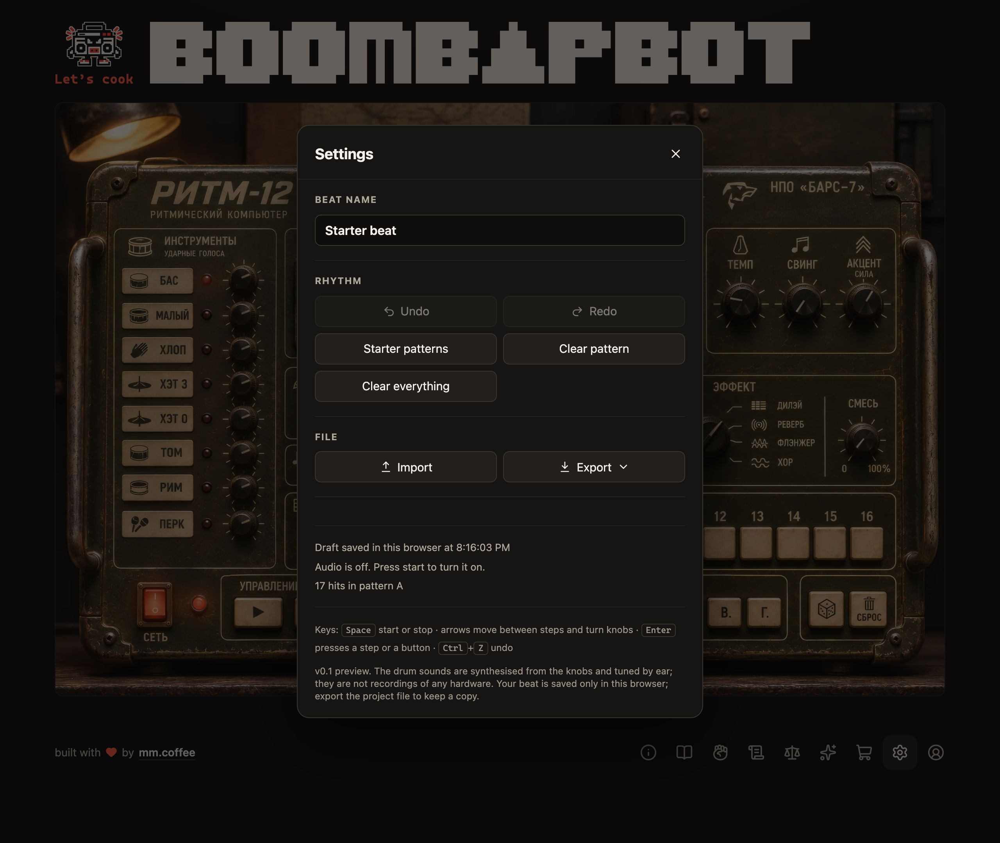

# boombapbot

A drums-only beat maker. This is **v0.1**: the web editor. The machine runs
entirely on your computer and needs no account. Accounts are optional: a
free one holds up to 20 saved beats, to pick up on another device. Accounts
and the shop are the only parts with a server behind them.


Open the editor and the page is a drum machine: РИТМ-12, a rhythm computer
that never existed, lettered in Russian. Press its play key and you hear a
pattern; press an instrument key to select it, press step keys to write it,
and work the knobs and switches in the picture. Everything else is behind
the cog in the footer: the beat's name, undo, and export as WAV, MIDI or a
project file. Reload and your beat is still there.

It has eight instruments, four patterns of sixteen steps with an accent row,
swing, a measure of sixteen steps or twelve, three sound knobs for each
instrument and one effect. It models no real machine: its sounds, its panel
and the maker's name on it were made for boombapbot.

The site had another machine first, the 808, built from a real machine's
operation manual. It is still in this repository as a second machine package
and is no longer shipped. [The 808](#the-808) says what is left of it here.

## Run it

You need Node 22.23.4 (`.nvmrc`), pnpm 10.28.0 (`corepack enable` provides
it), CMake 3.22 or newer, Ninja, a C++20 compiler, Python 3 and git.

```bash
./scripts/setup-emsdk.sh
```

```bash
pnpm install
```

```bash
pnpm build:engine
```

```bash
pnpm build:wasm
```

```bash
pnpm dev
```

Then open http://localhost:4321.

- `setup-emsdk.sh` installs Emscripten 6.0.13 (pinned in `.emscripten-version`)
  into `.tools/emsdk`. It is needed once and touches nothing outside the repo.
- `build:engine` builds the native C++ core and runs its tests. `build:wasm`
  builds the same sources to WebAssembly.
- The machine reads no environment variables and makes no network requests
  beyond its own files. Accounts need a few; see [Accounts](#accounts).

To try the production build instead:

```bash
pnpm build
```

```bash
pnpm serve
```

## What v0.1 does

- **A page that is just the machine.** The brand along the top, the drum
  machine, and a footer 50px under it. The footer's icons lead to the About,
  Docs, manifesto, Credits and Policies pages and open modals for upgrades,
  the cart, settings and your account; each shows its name when pointed at.
  Settings holds the beat name, undo and redo, a reset to the starter
  patterns, a clear for one pattern and one for everything, import and
  export, and the save and audio status. The upgrade is not built: its modal
  says so. The cart is a shop (see [Shop](#shop)).
- **Accounts, if you want one.** The account button opens a modal to make an
  account, confirm the address from an emailed link, log in and out, and
  reset a forgotten password. Logged in, it saves the beat on the machine
  to the account, lists what is saved there, and loads or deletes one (see
  [Saved beats](#saved-beats)).
- **One machine, РИТМ-12.** The panel is one picture, and every key, knob,
  switch and lamp in it is live on top of it. Knobs are dragged up and down
  or turned with the arrow keys; the write, size and effect controls step to
  their next position when pressed. The power switch turns it all off: the
  machine stops, goes dark and answers nothing else. What is lettered on the
  picture is Russian; every control's accessible name is English, and a
  control that moves says what it did on the machine's screen and to a
  screen reader.
- **About and Docs** are pages of their own on the same Astro site, with the
  same header and footer. Docs goes through every control and says what its
  lettering means. Credits is a blank page for now.
- **Eight sounds, synthesised.** Kick, snare, clap, closed and open hat, tom,
  rim and percussion. The engine builds each one from its pitch, decay and
  tone knobs, so turning one re-synthesises that sound. Nothing is a
  recording and nothing copies a real machine. See
  [Sounds](#sounds-provenance).
- **Four patterns to write.** А, Б, В and Г, each a measure of sixteen steps
  with a row for every instrument and one for accents. The write switch
  turns the step keys from hits to accents. Record writes the instrument
  keys you tap in time, as one undo step. The die writes a new row for the
  selected instrument, mute silences it, and clear empties the pattern. A
  pattern chosen while another plays takes over at the bar line, which the
  engine decides on the audio clock.
- **Measure, tempo and swing.** A measure is sixteen steps, four to the beat,
  or twelve steps of triplets. Tempo runs from 40 to 300 beats a minute, and
  swing plays every second step late, up to 75%. Triplets do not swing.
- **One effect on the mix.** An echo, a reverb, a flanger or a chorus, with a
  mix knob. At 0 the effect is out of the path altogether.
- **A screen and a meter.** The screen shows the pattern, the tempo and what
  the last control did; the meter shows how loud the output is. Both are
  drawn by the page as it plays.
- **Starter patterns.** A new machine has a beat on А and a busier turn of
  it on Б; В and Г are empty. They were written for boombapbot, and settings
  can put them back.
- **One engine everywhere.** A C++20 drum machine core (`engine/`) with a C
  ABI: a bank of 32 one-measure patterns of up to 32 steps at three, four,
  six or eight steps to the beat, a sequencer that picks the pattern for each
  measure, swing by pattern, one effect on the mix, a fixed pool of voices
  with deterministic stealing, and step times computed from the audio sample
  clock on a 24-ticks-per-beat timeline. A machine supplies the voices. The
  browser runs its WebAssembly build inside an AudioWorklet; export uses a
  second instance of the same engine. There is no separate JavaScript engine.
- **Saving.** The project is saved to this browser on every edit and restored
  on reload. A draft that fails validation is set aside, not deleted.
- **Beats from the earlier machine.** A draft, a project file or a saved
  beat made on the 808 opens as a РИТМ-12 beat: the rhythm that machine was
  on becomes pattern А, and the page lists what did not come across. It is a
  new beat here. The earlier draft stays in the browser where it was, and a
  beat in an account is never written over: saving the converted one adds a
  beat. The server stores only РИТМ-12 beats. A page left open since before
  the change, which would still send an 808 beat, is told to reload.
- **Import and export.** Project JSON (validated with Zod; an invalid file is
  rejected and never replaces the current beat), PCM WAV (24 or 16-bit
  stereo, 44.1 kHz) and a Type 1 Standard MIDI File with a tempo track and
  General MIDI drum notes on channel 10. WAV and MIDI hold the pattern the
  panel is on, as a seamless loop of one measure.



## The machine

| Part of РИТМ-12 | State |
| --- | --- |
| Eight sounds from their pitch, decay and tone knobs | Working. The owner has heard them once and said they sound good; nobody has gone through them one by one |
| Eight instrument keys with lamps and level knobs, and volume | Working; how far each level reaches was set by measurement |
| Sixteen step keys, and the write switch between hits and accents | Working |
| Accent row and its strength knob | Working |
| Four patterns, changed at the bar line while playing | Working |
| Record: instrument keys tapped in time | Working, to the nearest step as the page sees it |
| Mute, dice and clear | Working |
| Measure of sixteen steps or twelve (triplets) | Working |
| Tempo, 40 to 300, and swing to 75% | Working |
| Echo, reverb, flanger and chorus, with a mix knob | Working; their levels and ranges were set by measurement, not by ear |
| Screen and level meter | Working |
| Power switch | Working |
| The picture | 2000 pixels wide. The owner's originals are 3072 wide and the art should be cut again from those |

## The 808

The machine the site had first is `packages/machine-808/`, with its voices,
its drawn faceplate, its project format (schema version 2) and its tests. It
does what its operation manual describes: sixteen sounds, twelve tracks and
an accent, thirty-two patterns with two write modes, manual play with intros
and fill-ins, and twelve rhythm tracks.

No build that is deployed includes it. `BOOMBAPBOT_MACHINE=808` in front of
`pnpm dev`, `pnpm build` or `pnpm test:e2e` runs it, and CI still builds it
and runs its panel's browser tests (`e2e/808/`). The tests of accounts,
saved beats and the shop no longer run against it. It is on its way out of
this repository, together with the generated 606, 707 and 909 kits, the
photographs in `assets/faceplates/` and the VST3 spike, which all belong to
it.

## Accounts

Accounts follow the same pattern as the owner's other apps: Better Auth with
email and password, Neon Postgres through Drizzle, and Resend for email. The
pages are still prerendered; only the routes under `/api` run on a server.

Copy `apps/site/.env.example` to `apps/site/.env` and fill in the first five
values. Then create the tables:

```bash
pnpm db:migrate
```

- To try accounts with no database and no email provider, set
  `DATABASE_URL=pglite:memory` and `EMAIL_OUTBOX=./.data/outbox`. The database
  then lives inside the server process and each email is written to that
  folder as a file.
- `pnpm build` makes the static pages in `apps/site/dist/client` and a Node
  server in `apps/site/dist/server`. `pnpm serve` serves the pages alone;
  `node apps/site/dist/server/entry.mjs` serves them with the API. On Vercel
  the build uses Vercel's adapter instead.
- Every table has an integer `id` and a `uuid`. Only the uuid ever leaves
  the server.
- After changing `apps/site/src/server/db/schema.ts`, run `pnpm db:generate`
  and commit the new migration.

What has been checked: the whole flow in a browser against the built server
with the in-process database and the outbox, and that the built server
reads from the real Neon database once it is migrated. On the live site, on
2026-11-16, the owner signed up and later reset a password: both emails
arrived through Resend and their links worked.

### Saved beats

A free account holds up to 20 beats, each at most 64 KB of project JSON.
Both numbers are constants in `packages/contracts/src/beats.ts`, enforced
by the server.

- Saving is explicit. "Save this beat to my account" in the account modal
  sends the project on the machine; nothing is sent otherwise, and there is
  no background sync. The draft in the browser stays the working copy.
- The list under the button shows each beat's name, when it was saved and
  its size, with a button to load it and one to delete it. Deleting asks
  first. Loading takes the same road as importing a project file: it is
  validated, and undo brings back the beat that was on the machine.
- Saving a beat that was loaded from the account, or saved to it before,
  replaces that copy. The last save wins, with one guard: if the copy in
  the account was saved after the one this device last loaded or saved, the
  page says so and asks whether to replace it or keep the cloud copy.
- The routes are `GET` and `POST /api/beats`, and `GET`, `PUT` and `DELETE
  /api/beats/<uuid>`. Each needs a session and only reaches the caller's
  own rows. What is stored is the project after the project codec has checked
  it, and only a РИТМ-12 beat is stored.
- Beats saved while the site was the 808 are still in the table as they
  were; nothing was migrated. Loading one converts it on the page, as a new
  beat that is not tied to the stored one, so saving it adds a beat and the
  original stays until it is deleted.
- The table is `beats` (`apps/site/drizzle/0002_beats.sql`). It has been in
  the real database since 2026-11-16, when the migration was run there.

What has been checked: all of the above in a browser against the built
server with the in-process database, and that the migration applied to the
real Neon database, leaving an empty `beats` table and the existing rows as
they were. On 2026-11-17, while the site was the 808, the owner saved a
beat on the live site from a computer and loaded it on an iPhone and an
Android phone. Deleting a saved beat, the newer-copy question and the limit
have only run in the tests, and so has loading an 808 beat on РИТМ-12:
nobody has opened a real stored one yet.

## Shop

The cart button opens the shop: what is for sale and a cart kept in the
browser. Checking out asks where the order is going, gets the shipping price
for that address from Printful, and then goes to Stripe Checkout to pay.
When Stripe says an order is paid, the site sends it to Printful to be
printed and posted. It ships wherever Printful does.

- `pnpm shop:sync` reads the Printful store's products, and the countries
  Printful delivers to, into `packages/contracts/data/shop.json` and saves
  the product pictures. It only reads. Commit what it writes.
- The shop opens when the catalog has a product and both `STRIPE_SECRET_KEY`
  and `PRINTFUL_API_KEY` are set. Until then the modal says it is not open.
- Orders live in an `orders` table (`apps/site/drizzle/0001_orders.sql`).
- Two webhooks have to be registered before it opens: Stripe's, to
  `/api/webhooks/stripe`, and Printful's, to
  `/api/webhooks/printful?secret=...`.
- Printful's can only be set through its API. `pnpm shop:webhook` shows what
  Printful has now and changes nothing; `pnpm shop:webhook --register` points
  it at the live site, after checking that the site takes the secret in
  `apps/site/.env`. It never prints the secret.

What has been checked: `pnpm shop:sync` and shipping quotes against the real
Printful store, and the whole purchase in a browser against the built server
with a stand-in for Stripe and Printful (`e2e/fake-shop-services.mjs`). What
has not: a real Printful shipping event, a refund, a purchase without an
account, and sales tax. The first real order went through on 2026-11-16:
paid at Stripe, accepted from Stripe's webhook, and placed with Printful.
The shop has been open on the live site since 2026-11-16, with both
webhooks registered (Printful's by `pnpm shop:webhook --register`).

## Tests

Run in this order; later steps use what earlier ones build.

| Command | What it checks |
| --- | --- |
| `pnpm kits:check` | The committed demo WAVs match their generator script |
| `pnpm faceplates:check` | The committed faceplate drawing matches its generator script, and carries no brand names |
| `pnpm build:engine` | Builds the native engine for both machines and runs CTest: the tick timeline, scheduler timing across buffer sizes and pre-scales, ten minutes without drift, the pattern bank and its 1st and 2nd parts, the sequencer (A, AB and B, intro, tapped and automatic fill-ins, the first-beat rule, songs and the measure log), accent and level smoothing, voices and stealing, hat chokes, MIDI, every synthesised sound across its knobs, swing, each effect, РИТМ-12's eight voices, the contract files, no allocation inside the render call, and the header compiling as C |
| `pnpm build:wasm` | Builds the engine to WebAssembly, one module for each machine |
| `pnpm typecheck` | TypeScript across packages, tests and the Astro site |
| `pnpm test:unit` | Vitest against the WASM build: the project schema and the move from version 1, the project-to-engine mapping, native versus WASM output for six rhythms of the fixture and for each synthesised sound, byte-identical MIDI from both builds, the engine's export list against its header and the TypeScript bridge, WAV and MIDI contents, import, draft recovery, store, the limits and the conflict rule for saved beats, what a device remembers about them; and for РИТМ-12 its project schema, what its controls do, its engine setup, and its reader for 808 beats, which become new beats |
| `pnpm build` | Production Astro build, then `scripts/check-build.mjs`: the worklet and the engine resolve in the built site, the engine is the one built for the machine and needs no shared memory, no sample files ship, and the panel art is byte for byte what is committed, with no other machine's beside it |
| `pnpm test:e2e` | Playwright against the production build in headless Chromium. РИТМ-12's panel: every key, knob and switch, the write and size switches, the effect, mute, dice and clear, power, playback and the bar-line pattern change, recording by tapping, the meter, exports, the draft, an 808 draft and an 808 file opening converted, the phone layout, and an accessibility scan. The site: the page layout and settings sheet, the header and footer, the modals, the pages of words. Against the built server with its database in memory: accounts, the shop, and saved beats (save, list, load, replace with and without the conflict question, delete, both limits, one account against another's beats, row ids, the machine with the server gone, an 808 beat loading as a new beat, and an 808 beat refused on save) |
| `BOOMBAPBOT_MACHINE=808 pnpm build`, then the same in front of `pnpm test:e2e` | The 808's build and its panel's browser tests: every selector position, knob and switch, the write modes, manual play, rhythm tracks, the power switch, dials, lamps, keyboard, touch layout, exports, its draft and an accessibility scan |

`pnpm test` runs the engine, unit and browser suites after a build.
`.github/workflows/ci.yml` runs the whole list on every push and pull request.

### Results

Run on macOS 26.6 on Apple silicon with Apple clang 21, Node 22.23.4,
Emscripten 6.0.13 and headless Chromium via Playwright 1.63.

| Step | Result |
| --- | --- |
| `pnpm kits:check` | 24 of 24 files match |
| `pnpm faceplates:check` | 1 of 1 drawing matches |
| `pnpm build:engine` | 15 CTest suites, all pass with Apple clang 21 |
| `pnpm build:wasm` | 68,940 bytes for РИТМ-12 and 71,396 for the 808, one import each, no threads or shared memory |
| `pnpm typecheck` | 0 errors |
| `pnpm test:unit` | 215 of 215 pass |
| `pnpm build` | Build check passes |
| `pnpm test:e2e` | 78 of 78 pass |
| The 808: `BOOMBAPBOT_MACHINE=808 pnpm build`, then `pnpm test:e2e` | Build check passes; 54 of 54 pass |

The VST3 spike and the engine under Clang, AddressSanitizer and
UndefinedBehaviorSanitizer were not run for this version on this machine. CI
runs them.

CI runs the same list on Linux x86-64 with GCC and Clang.

Two cross-checks worth knowing about:

- **Native versus WASM.** For six rhythms of the 808's fixture, at four
  pre-scales and with a 2nd part, event frames are identical, audio agrees to
  within two 24-bit steps (four with an effect on) and the MIDI files are
  the same byte for byte. Each synthesised sound agrees to within one 24-bit
  step. The remaining
  difference is the last bit of `exp`, `tanh`, `sin` and `cos` between the
  native C library and the WASM one.
- **Buffer size.** Output is bit-identical whether rendered in one call, one
  frame at a time, or in blocks of 17, 64, 128, 441, 1024 or 4096 frames.

### What was not verified

- **Listening.** The owner has listened to РИТМ-12 once, on a local build,
  and said it sounds good. Nobody has gone through its voices, its knobs'
  reach or its four effects one by one. Otherwise audio is checked
  numerically: the worklet reports nonzero output, the meter rises, exported
  WAVs contain audio at the right length, and native and WASM renders agree.
- **РИТМ-12 on the live site.** Everything the owner has done on
  boombapbot.com was done while it was the 808. Nobody has opened РИТМ-12
  there, opened a real 808 draft or a real stored 808 beat on it, or saved
  from a page left open across the change. Those run in the tests only.
- **Browsers other than headless Chromium.** РИТМ-12's panel has been run in
  Chromium only. No real phone, Safari or Firefox has shown it; the phone
  layout was checked in Chromium's device emulation. On 2026-11-17, on the
  808, the owner logged in, loaded a beat and played it on an iPhone in
  Safari and in Chrome and on a Samsung Galaxy S9 in Chrome.
- **Deployment.** `.github/workflows/deploy.yml` builds the site and hands it
  to Vercel after CI passes on `main`. It ran for the first time on
  2026-11-16, and the live site was checked by hand afterwards: the machine
  plays, the pages load and the server answers. The owner signed up there
  the same day and reset a password, and both emails worked. The first real
  order went through that day too: paid at Stripe, accepted from Stripe's
  webhook and placed with Printful. A real Printful shipping event, a
  refund and a purchase without an account have not been tried there.
- **Saved beats on the live site.** The tests use a Postgres inside the
  server process, built from the same migrations. On the live site the
  owner has saved and loaded across three devices; deleting a saved beat,
  the newer-copy question and the limit have not been tried there.
- **Deleting an account.** Built and tested against the in-process
  database. Nobody has deleted an account through the page on the live
  site.
- **Device performance.** See the benchmark below; it says nothing about
  phones.

To reproduce the audio check by hand: `pnpm dev`, then press the panel's
play key.

### Engine load

`pnpm bench` renders a worst case through the 808's WASM engine: every track on
every step of a 32-step measure of thirty-second notes at 300 BPM, with every
decay knob fully right, in 128-frame blocks. On the machine above that ran
about 200 times faster than real time, with the slowest block taking 0.3 ms
of its 2.67 ms budget and output bounded. A track has one voice, so the pool
of 64 is never full in normal use. This is a desktop number.

## Sounds: provenance

РИТМ-12's eight sounds are synthesised by the engine itself, in
[`packages/machine-ritm12/engine/voices.cpp`](packages/machine-ritm12/engine/voices.cpp),
each built from its pitch, decay and tone knobs. They were written for
boombapbot and copy no real machine; nothing in them is sampled. The browser
synthesises each sound on its main thread at the device's sample rate and
hands the samples to the audio thread; no sound files ship.

The 808's sixteen sounds
([`packages/machine-808/engine/voices.cpp`](packages/machine-808/engine/voices.cpp))
are a model made by ear, never compared with a real machine. `assets/kits/`
still holds generated sample kits for the 606, 707 and 909, made by
[`scripts/gen_demo_kits.py`](scripts/gen_demo_kits.py). Nothing loads them.

## The panel

РИТМ-12's panel is one picture, the owner's own artwork, with every control
live on top of it at the place it is painted
([`packages/machine-ritm12/src/ui/layout.ts`](packages/machine-ritm12/src/ui/layout.ts)).
The machine in it never existed: its maker, its name and its lettering are
invented, so there is nobody to credit. The art is committed in
[`packages/machine-ritm12/art/`](packages/machine-ritm12/art/README.md):
the plate, a patch for each other position of a stepped control, and the
pointer line of each kind of knob. `check-build` fails a build whose art is
not byte for byte what is committed.

`misc/assets/` holds the owner's unedited originals. It is ignored by git,
and nothing from it reaches a build.

On a phone the picture keeps a size that can be worked and scrolls sideways,
or fits the screen at the press of a button. An instrument strip sits under
it, and play and the tempo are docked at the bottom of the screen.

The 808's faceplate is a drawing made by
`packages/machine-808/art/draw-faceplate.mjs`. `assets/faceplates/` keeps
the owner's edits of Creative Commons photographs of the 606, 707, 808 and
909 with the brand names removed. No build ships them.

## Layout

| Path | Contents |
| --- | --- |
| `engine/` | C++20 core with no voices of its own, C ABI, the CMake function that builds it for a machine, CTest suites, render tool |
| `packages/contracts/` | What every project document carries, and the saved-beat and shop schemas |
| `packages/editor/` | React editor core: store, runtime, AudioWorklet bridge, exporters, local draft, the account and shop modals, and the contract a machine fills in |
| `packages/machine-ritm12/` | РИТМ-12, the machine the site is: its project schema, voices, panel, art, and the reader that opens the 808's beats |
| `packages/machine-808/` | The 808, not shipped: its project schema, data files and fixtures, voices, panel art and styles, and what its controls do. Run it with `BOOMBAPBOT_MACHINE=808 pnpm dev` |
| `apps/site/` | Astro site: the machine as a client-only island, the pages of words, and the server routes for accounts, saved beats and the shop |
| `assets/kits/` | Generated sample kits for the 606, 707 and 909, not loaded at the moment |
| `assets/faceplates/` | Cleared photographs of the classic machines and their provenance, not shipped |
| `plugins/vst3/` | JUCE VST3 compile spike, outside the web build |
| `e2e/` | Playwright tests: the site's, and each machine's own in `e2e/ritm12/` and `e2e/808/` |
| `scripts/` | Toolchain setup, builds, asset preparation, build check, benchmark |
| `misc/assets/` | The owner's unedited faceplate originals (ignored by git) |

## File formats

- **Project JSON** (`.boombapbot.json`, `format: "boombapbot.project"`,
  `schemaVersion: 3`, `machine: "ritm12"`): everything the machine
  remembers. The tempo in beats a minute, swing, the size of a measure, four
  patterns of eight sixteen-step rows and an accent row, the volume, accent
  strength, levels and mutes, each instrument's pitch, decay and tone, the
  effect and its mix, and where the panel stands. Version 2 files (the 808)
  and version 1 files (the one-pattern editor before it) still open, as a
  new РИТМ-12 beat. This is the draft and interchange file. It is **not**
  the future portable `.boombapbot` bundle.
- **WAV**: the pattern the panel is on as a loop of one measure, with swing
  and the effect in it. It is played often enough for the effect's tail to
  settle, and the last pass is kept, so the end wraps into the start.
- **MIDI**: Type 1, 480 PPQ, a tempo track and a drum track on channel 10.
  Notes are placed on the same tick timeline the audio scheduler uses, 20
  MIDI ticks to an engine tick, swing included, so they cannot drift apart.
  An accented step is written at a higher velocity. It holds the same
  measure as the WAV.

## VST3 compile spike

`plugins/vst3/` is a small JUCE VST3 instrument that links the same engine,
synthesises the 808's sounds at the host's sample rate and plays them from
MIDI notes, placing each hit on its sample offset inside the block. It is a
separate CMake project and is not part of the web build. JUCE 8.0.9 is
fetched at configure time, not vendored.

```bash
cmake -S plugins/vst3 -B build/vst3 -G Ninja -DCMAKE_BUILD_TYPE=Release
```

```bash
cmake --build build/vst3
```

```bash
ctest --test-dir build/vst3 --output-on-failure
```

On macOS this compiles and produces an Apple silicon `.vst3` bundle that
exports the VST3 entry points and contains the engine, and the processor
self-test passes. That is all it shows. An earlier version was built the same
way on Linux; this one has not been. **Scanning in a host, the Steinberg validator, transport sync and
state recall in a host are all pending**, as is a Windows build. JUCE 8 is
AGPLv3 or commercial, and a licence path has to be chosen before anything
built from it is distributed. Details and the full not-verified list:
[`plugins/vst3/README.md`](plugins/vst3/README.md).

## Next milestone

In the build spec's sequence, v0.1 covers the web half of "prove the platform
stack" and most of "build one end-to-end beat". Next:

1. Try РИТМ-12 where it has not been: on a real phone, in Safari and in
   Firefox, and listen to it voice by voice and effect by effect. What the
   build guesses at is listed in [`docs/follow-ups.md`](docs/follow-ups.md).
2. Cut its art again from the owner's full-size pictures.
3. Move the 808 and what belongs to it out of this repository.
4. Boot the same engine natively: Tauri with CPAL on desktop, Capacitor with
   AVAudioEngine and Oboe on mobile.

Saving beats to an account is built. Sync in the background, billing,
signing and store submission come after that.
