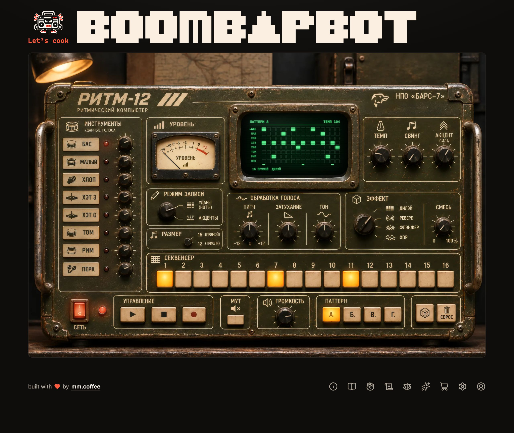

# boombapbot

A drums-only beat maker. This is **v0.1**: the web editor. The machine runs
entirely on your computer and needs no account. Accounts are optional: a
free one holds up to 20 saved beats, to pick up on another device. Accounts
and the shop are the only parts with a server behind them.



Open the editor and the page is a drum machine: РИТМ-12, a rhythm computer
that never existed, lettered in Russian. Press its play key and you hear a
pattern; press an instrument key to select it, press step keys to write it,
and work the knobs and switches in the picture. Everything else is behind
the cog in the footer: the beat's name, undo, and export as WAV, MIDI or a
project file. Reload and your beat is still there.

It has eight instruments, four patterns of sixteen steps with an accent row,
swing, a measure of sixteen steps or twelve, three sound knobs for each
instrument and one effect. It models no real machine: its sounds, its panel
and the maker's name on it were made for boombapbot.

The site had another machine first, modelled on a real one from its
operation manual. It is no longer in this repository. Beats made on it still
open here, as РИТМ-12 beats.

## Run it

You need Node 22.23.4 (`.nvmrc`), pnpm 10.28.0 (`corepack enable` provides
it), CMake 3.22 or newer, Ninja, a C++20 compiler, Python 3 and git.

```bash
./scripts/setup-emsdk.sh
```

```bash
pnpm install
```

```bash
pnpm build:engine
```

```bash
pnpm build:wasm
```

```bash
pnpm dev
```

Then open http://localhost:4321.

- `setup-emsdk.sh` installs Emscripten 6.0.13 (pinned in `.emscripten-version`)
  into `.tools/emsdk`. It is needed once and touches nothing outside the repo.
- `build:engine` builds the native C++ core and runs its tests. `build:wasm`
  builds the same sources to WebAssembly.
- The machine reads no environment variables and makes no network requests
  beyond its own files. Accounts need a few; see [Accounts](#accounts).

To try the production build instead:

```bash
pnpm build
```

```bash
pnpm serve
```

## What v0.1 does

- **A page that is just the machine.** The brand along the top, the drum
  machine, and a footer 50px under it. The footer's icons lead to the About,
  Docs, manifesto and Policies pages and open modals for upgrades,
  the cart, settings and your account; each shows its name when pointed at.
  On a phone, where nothing can be pointed at, they are their names in
  words, in one row, with "by mm.coffee" under it.
  Settings holds the beat name, undo and redo, a reset to the starter
  patterns, a clear for one pattern and one for everything, import and
  export, and the save and audio status. The upgrade is not for sale: its
  modal says so, and the server behind it is switched off (see
  [Upgrade](#upgrade)). The cart is a shop (see [Shop](#shop)).
- **Accounts, if you want one.** The account button opens a modal to make an
  account, confirm the address from an emailed link, log in and out, and
  reset a forgotten password. Logged in, it saves the beat on the machine
  to the account, lists what is saved there, and loads or deletes one (see
  [Saved beats](#saved-beats)).
- **One machine, РИТМ-12.** The panel is one picture, and every key, knob,
  switch and lamp in it is live on top of it. Knobs are dragged up and down
  or turned with the arrow keys; the write, size and effect controls step to
  their next position when pressed. The power switch turns it all off: the
  machine stops, goes dark and answers nothing else. What is lettered on the
  picture is Russian; every control's accessible name is English, and a
  control that moves says what it did on the machine's screen and to a
  screen reader.
- **Pages of words.** About, Docs, the manifesto, Credits and Policies are
  pages of their own on the same Astro site, with the same footer. Their
  header is a compact masthead that names every page beside the brand, so
  nothing has to be pointed at to find them. About opens on a still of the
  machine with its screen lit and a key that opens it. Docs goes through
  every control and says what its lettering means. The manifesto is one
  narrow column. Credits is a blank page for now, at `/credits`, and nothing
  leads to it until it has something on it. They are set in two faces
  the site serves itself, PT Serif and Sofia Sans Condensed.
- **Eight sounds, synthesised.** Kick, snare, clap, closed and open hat, tom,
  rim and percussion. The engine builds each one from its pitch, decay and
  tone knobs, so turning one re-synthesises that sound. Nothing is a
  recording and nothing copies a real machine. See
  [Sounds](#sounds-provenance).
- **Four patterns to write.** А, Б, В and Г, each a measure of sixteen steps
  with a row for every instrument and one for accents. The write switch
  turns the step keys from hits to accents. Record writes the instrument
  keys you tap in time, as one undo step. The die writes a new row for the
  selected instrument, mute silences it, and clear empties the pattern. A
  pattern chosen while another plays takes over at the bar line, which the
  engine decides on the audio clock.
- **Measure, tempo and swing.** A measure is sixteen steps, four to the beat,
  or twelve steps of triplets. Tempo runs from 40 to 300 beats a minute, and
  swing plays every second step late, up to 75%. Triplets do not swing.
- **One effect on the mix.** An echo, a reverb, a flanger or a chorus, with a
  mix knob. At 0 the effect is out of the path altogether.
- **A screen and a meter.** The screen shows the pattern, the tempo and what
  the last control did; the meter shows how loud the output is. Both are
  drawn by the page as it plays.
- **Starter patterns.** A new machine has a beat on А and a busier turn of
  it on Б; В and Г are empty. They were written for boombapbot, and settings
  can put them back.
- **One engine everywhere.** A C++20 drum machine core (`engine/`) with a C
  ABI: a bank of 32 one-measure patterns of up to 32 steps at three, four,
  six or eight steps to the beat, a sequencer that picks the pattern for each
  measure, swing by pattern, one effect on the mix, a fixed pool of voices
  with deterministic stealing, and step times computed from the audio sample
  clock on a 24-ticks-per-beat timeline. A machine supplies the voices. The
  browser runs its WebAssembly build inside an AudioWorklet; export uses a
  second instance of the same engine. There is no separate JavaScript engine.
- **Saving.** The project is saved to this browser's IndexedDB, by project
  id, shortly after each edit and at once when the page is hidden or
  closed, and restored on reload. A draft the site kept in `localStorage`
  before is moved across on the first visit. One tab at a time saves the
  draft: another tab that opens it says so and saves nothing until asked to
  work there. A draft that fails validation is set aside, not deleted.
- **Beats from the earlier machine.** A draft, a project file or a saved
  beat made on the machine the site had first opens as a РИТМ-12 beat: the rhythm that machine was
  on becomes pattern А, and the page lists what did not come across. It is a
  new beat here. The earlier draft stays in the browser where it was, and a
  beat in an account is never written over: saving the converted one adds a
  beat. The server stores only РИТМ-12 beats. A page left open since before
  the change, which would still send the earlier kind, is told to reload.
- **Import and export.** Project JSON (validated with Zod; an invalid file is
  rejected and never replaces the current beat), PCM WAV (24 or 16-bit
  stereo, 44.1 kHz) and a Type 1 Standard MIDI File with a tempo track and
  General MIDI drum notes on channel 10. WAV and MIDI hold the pattern the
  panel is on, as a seamless loop of one measure. A WAV renders in a Worker,
  and settings says where it stands.


## The machine

| Part of РИТМ-12 | State |
| --- | --- |
| Eight sounds from their pitch, decay and tone knobs | Working. The owner has heard them once and said they sound good; nobody has gone through them one by one |
| Eight instrument keys with lamps and level knobs, and volume | Working; how far each level reaches was set by measurement |
| Sixteen step keys, and the write switch between hits and accents | Working |
| Accent row and its strength knob | Working |
| Four patterns, changed at the bar line while playing | Working |
| Record: instrument keys tapped in time | Working, to the nearest step as the page sees it |
| Mute, dice and clear | Working |
| Measure of sixteen steps or twelve (triplets) | Working |
| Tempo, 40 to 300, and swing to 75% | Working |
| Echo, reverb, flanger and chorus, with a mix knob | Working; their levels and ranges were set by measurement, not by ear |
| A crusher, tape, a pump, a filter, vinyl and a phaser | In the engine only, for the upgrade: no control reaches them and no project can ask for them yet. Set by measurement; nobody has listened |
| Screen and level meter | Working |
| Power switch | Working |
| The picture | 2000 pixels wide. The owner's originals are 3072 wide and the art should be cut again from those |

## Accounts

Accounts follow the same pattern as the owner's other apps: Better Auth with
email and password, Neon Postgres through Drizzle, and Resend for email. The
pages are still prerendered; only the routes under `/api` run on a server.

Copy `apps/site/.env.example` to `apps/site/.env` and fill in the first five
values. Then create the tables:

```bash
pnpm db:migrate
```

- To try accounts with no database and no email provider, set
  `DATABASE_URL=pglite:memory` and `EMAIL_OUTBOX=./.data/outbox`. The database
  then lives inside the server process and each email is written to that
  folder as a file.
- `pnpm build` makes the static pages in `apps/site/dist/client` and a Node
  server in `apps/site/dist/server`. `pnpm serve` serves the pages alone;
  `node apps/site/dist/server/entry.mjs` serves them with the API. On Vercel
  the build uses Vercel's adapter instead.
- `DATABASE_URL=pglite:./.data/dev` keeps that database in a folder, and
  the folder can be opened again.
- Logging in, signing up and asking for an email are rate limited by Better
  Auth, by the address a request came from. The counts are rows in the
  `rate_limits` table, so every server on Vercel counts together. Asking who
  is logged in, which every page does, is not counted.
- Every table has an integer `id` and a `uuid`. Only the uuid ever leaves
  the server.
- After changing `apps/site/src/server/db/schema.ts`, run `pnpm db:generate`
  and commit the new migration.

What has been checked: the whole flow in a browser against the built server
with the in-process database and the outbox, and that the built server
reads from the real Neon database once it is migrated. On the live site, on
2026-11-16, the owner signed up and later reset a password: both emails
arrived through Resend and their links worked.

The rate limit's table (`apps/site/drizzle/0004_rate_limits.sql`) has been
in the real database since 2026-11-18, when the migration was run there,
before the code that uses it was deployed.

### Saved beats

A free account holds up to 20 beats, each at most 64 KB of project JSON.
Both numbers are constants in `packages/contracts/src/beats.ts`, enforced
by the server.

- Saving is explicit. "Save this beat to my account" in the account modal
  sends the project on the machine; nothing is sent otherwise, and there is
  no background sync. The draft in the browser stays the working copy.
- The list under the button shows each beat's name, when it was saved and
  its size, with a button to load it and one to delete it. Deleting asks
  first. Loading takes the same road as importing a project file: it is
  validated, and undo brings back the beat that was on the machine.
- Saving a beat that was loaded from the account, or saved to it before,
  replaces that copy. The last save wins, with one guard: if the copy in
  the account was saved after the one this device last loaded or saved, the
  page says so and asks whether to replace it or keep the cloud copy.
- The routes are `GET` and `POST /api/beats`, and `GET`, `PUT` and `DELETE
  /api/beats/<uuid>`. Each needs a session and only reaches the caller's
  own rows. What is stored is the project after the project codec has checked
  it, and only a РИТМ-12 beat is stored.
- Beats saved while the site was the earlier machine are still in the table
  as they were; nothing was migrated. Loading one converts it on the page, as a new
  beat that is not tied to the stored one, so saving it adds a beat and the
  original stays until it is deleted.
- The table is `beats` (`apps/site/drizzle/0002_beats.sql`). It has been in
  the real database since 2026-11-16, when the migration was run there.

What has been checked: all of the above in a browser against the built
server with the in-process database, and that the migration applied to the
real Neon database, leaving an empty `beats` table and the existing rows as
they were. On 2026-11-18 the owner saved a РИТМ-12 beat on the live site
from desktop Chrome and loaded it in Firefox on an iPhone. Deleting a saved
beat, the newer-copy question and the limit have only run in the tests, and
so has loading a beat of the earlier machine: nobody has opened a real
stored one, and the owner had saved none.

## Shop

The cart button opens the shop: what is for sale and a cart kept in the
browser. Checking out asks where the order is going, gets the shipping price
for that address from Printful, and then goes to Stripe Checkout to pay.
When Stripe says an order is paid, the site sends it to Printful to be
printed and posted. It ships wherever Printful does.

- `pnpm shop:sync` reads the Printful store's products, and the countries
  Printful delivers to, into `packages/contracts/data/shop.json` and saves
  the product pictures. It only reads. Commit what it writes.
- The shop opens when the catalog has a product and both `STRIPE_SECRET_KEY`
  and `PRINTFUL_API_KEY` are set. Until then the modal says it is not open.
- Orders live in an `orders` table (`apps/site/drizzle/0001_orders.sql`).
- Two webhooks have to be registered before it opens: Stripe's, to
  `/api/webhooks/stripe`, and Printful's, to
  `/api/webhooks/printful?secret=...`.
- Printful's can only be set through its API. `pnpm shop:webhook` shows what
  Printful has now and changes nothing; `pnpm shop:webhook --register` points
  it at the live site, after checking that the site takes the secret in
  `apps/site/.env`. It never prints the secret.

What has been checked: `pnpm shop:sync` and shipping quotes against the real
Printful store, and the whole purchase in a browser against the built server
with a stand-in for Stripe and Printful (`e2e/fake-shop-services.mjs`). What
has not: a real Printful shipping event, a refund, a purchase without an
account, and sales tax. The first real order went through on 2026-11-16:
paid at Stripe, accepted from Stripe's webhook, and placed with Printful.
The shop has been open on the live site since 2026-11-16, with both
webhooks registered (Printful's by `pnpm shop:webhook --register`).

## Upgrade

A one-time payment of 5 dollars that gives a license key. The server side
and its modal exist, and it is switched off: nothing checks for it yet, and
which features it will unlock is not decided.

- It sells nothing until `UPGRADE_OPEN` is `on` and Stripe's key and webhook
  secret are set. Until then `/api/upgrade/checkout` refuses.
- `POST /api/upgrade/checkout` sends the buyer to Stripe Checkout. No account
  is needed. The same Stripe webhook as the shop's hears that it was paid,
  makes one license and emails its key, however often Stripe says so.
- A key looks like `BOOM-7K3QF-9XW2M-HT4RD-6VNPA`. Someone logged in when
  they paid has it on their account at once; anyone else enters it in an
  account later (`POST /api/upgrade/redeem`). One key, one account.
- `GET /api/upgrade` says whether it is open, the price, and whether the
  account asking is upgraded. `GET /api/upgrade/key` gives an account its
  key, and `POST /api/upgrade/key` emails the keys bought with an address
  to that address again, each at most once in ten minutes.
- Licenses live in a `licenses` table (`apps/site/drizzle/0003_licenses.sql`).
  A deleted account leaves its license behind with its key free to use again.
- The upgrade icon's modal (`packages/editor/src/ui/Upgrade.tsx`) asks
  `GET /api/upgrade` when it is opened, never before. Closed, it says what it
  has always said and offers nothing to press. Open, it shows the price and a
  button that goes to Stripe, a way to enter a key (which needs an account,
  so it leads to the account modal first), and a way to have a lost key
  emailed again. An upgraded account sees its key, with a button to copy it.
- Stripe sends the buyer back to `/?upgrade=paid`, or to `/?upgrade=open` if
  they changed their mind; the modal opens on either and takes the parameter
  out of the address. Someone back before Stripe's webhook has arrived is
  thanked and not offered it again, and a logged-in buyer is looked up every
  two seconds, for half a minute, until the key is on the account.
- The modal's words for the open upgrade are stand-ins, and none of them says
  what the upgrade unlocks. They are the owner's to write before it is sold.

What has been checked: all of the above against the built server with its
database in memory and a stand-in for Stripe (`e2e/upgrade.spec.ts`), the
modal included, and the modal by hand on that same server at a computer's
width and a phone's. What
has not: anything against real Stripe or a real email, and nothing has
written to the live database, which has had the empty `licenses` table
since 2026-11-17, when the migration was run there.

## Tests

Run in this order; later steps use what earlier ones build.

| Command | What it checks |
| --- | --- |
| `pnpm build:engine` | Builds the native engine and runs CTest, the engine's own suites with a test machine of two plain voices: the tick timeline, scheduler timing across buffer sizes and pre-scales, ten minutes without drift, the pattern bank and its 1st and 2nd parts, the sequencer (A, AB and B, intro, tapped and automatic fill-ins, the first-beat rule, songs and the measure log), accent and level smoothing, voices and stealing, hat chokes, MIDI, the synthesis calls, swing, each effect, no allocation inside the render call, and the header compiling as C; then РИТМ-12's eight voices across their knobs |
| `pnpm build:wasm` | Builds the engine to WebAssembly |
| `pnpm typecheck` | TypeScript across packages, tests and the Astro site |
| `pnpm test:unit` | Vitest against the WASM build: РИТМ-12's project schema, what its controls do, its engine setup and its reader for the earlier machine's beats, which become new beats; РИТМ-12 through the native engine and the WASM one from the same setup (every pattern of its fixture, swing, triplets, each effect, and byte-identical MIDI) and each of its sounds; offline rendering, songs, intros and fill-ins with a setup written by hand; the editor playing through a controller a shell hands it, with stand-ins for one that takes samples and one that makes its own sounds, and the controller of a native engine against a fake bridge (the order of commands, an engine made again being told the beat again); the desktop app's page asking only for commands the app has, and the phone app's only for what its engine plug-in has; WAV and MIDI contents; a WAV export's Worker job against the same render on the main thread, byte for byte; who a session answer says is logged in; the engine's export list against its header and the TypeScript bridge; drafts (kept in IndexedDB, moved out of `localStorage`, and which tab keeps them), import, the limits and the conflict rule for saved beats, and what a device remembers about them |
| `pnpm build` | Production Astro build, then `scripts/check-build.mjs`: the worklet and the engine resolve in the built site, the engine is the one built for the machine and needs no shared memory, no sample files ship, and the panel art is byte for byte what is committed, with no other machine's beside it |
| `pnpm test:e2e` | Playwright against the production build in headless Chromium. РИТМ-12's panel: every key, knob and switch, the write and size switches, the effect, mute, dice and clear, power, playback and the bar-line pattern change, recording by tapping, the meter, WAV and MIDI exports with the Worker held up and failing, the draft, a draft and a file of the earlier machine opening converted, the picture on a phone that asks for it, the phone's panel (the view following the screen's width and keeping the beat, its keys' size, writing and playing a pattern, the three tabs of knobs, power, and an accessibility scan of each tab), and an accessibility scan. The site: the page layout and settings sheet, a draft that cannot be written, a draft moved out of `localStorage`, a change kept when the tab closes, two tabs on one draft, the header and footer, the modals, the pages of words (one heading each, the masthead and its names, a phone's width, About's picture, the manifesto's column, an accessibility scan) the spaces a line break must not swallow, and a host that answers for the account server without being one. Against the built server with its database in memory: accounts (and, on a second server with the limits on and its database in a folder, an address turned away after three tries, the check of who is logged in left uncounted, and the count still there after the server is started again), the shop, the upgrade (checkout, one key for one payment, the key by email and from the account, entering a key, the switch that keeps it closed, and its modal: buying with and without an account, the wait for Stripe, the key shown and copied, a key entered, a lost key asked for, and the closed modal), and saved beats (save, list, load, replace with and without the conflict question, delete, both limits, one account against another's beats, row ids, the machine with the server gone, a beat of the earlier machine loading as a new beat, and one refused on save) |

`pnpm test` runs the engine, unit and browser suites after a build.
`.github/workflows/ci.yml` runs the whole list on every push and pull request.

The desktop app has two checks of its own. They need Rust, and
`pnpm prepare:assets` first. `.github/workflows/native.yml` builds the app
on macOS and Windows and runs `test:engine` on both. It does not run
`check:run`, which makes sound.

| Command | What it checks |
| --- | --- |
| `pnpm --filter @boombapbot/desktop test:engine` | `cargo test`: the app's bindings against the engine linked into it (the ABI version and the size of each struct), every command and report in the editor's spelling, and the audio thread's half with no sound device: no heap call while buffers are filled, a beat in the buffer for a device of one, two or six channels, and the page told what the worklet would tell it, as often |
| `pnpm --filter @boombapbot/desktop check:run` | Builds the app and runs it with `BOOMBAPBOT_DESKTOP_CHECK` set: the page plays the starter beat for three seconds through the default sound device, then exports a WAV, a MIDI file and a project file to a folder of its own, and the app prints what the page saw and what the engine did and exits with 0 only if neither side's peak was silent. `BOOMBAPBOT_DESKTOP_CHECK=reopen` also makes the engine again halfway, as a change of device does. It makes sound |

The phone app's engine plug-in has checks of its own as well. On iOS they
need Xcode and the engine built for iOS (`pnpm --filter @boombapbot/mobile
engine:ios`); on Android, the NDK and CMake its `build.gradle` names. Its
tests run in a simulator or an emulator, and the app checks itself in one
as the desktop app does, but for exports. `apps/mobile/README.md` has the
commands. `.github/workflows/native.yml` runs the plug-in's tests in an
iPhone simulator on macOS and in an Android emulator on Linux. It does not
build the app or run its check.

### Results

Run on macOS 26.6 on Apple silicon with Apple clang 21, Node 22.23.4,
Emscripten 6.0.13 and headless Chromium via Playwright 1.63. On 2026-11-18
the browser tests also passed in that Playwright's builds of WebKit and
Firefox (`BOOMBAPBOT_E2E_BROWSER=webkit pnpm test:e2e`); CI does not run
them.

| Step | Result |
| --- | --- |
| `pnpm build:engine` | 14 CTest suites, all pass with Apple clang 21 |
| `pnpm build:wasm` | 68,940-byte module, one import, no threads or shared memory |
| `pnpm typecheck` | 0 errors |
| `pnpm test:unit` | 117 of 117 pass |
| `pnpm build` | Build check passes |
| `pnpm test:e2e` | 78 of 78 pass |

The engine under Clang, AddressSanitizer and UndefinedBehaviorSanitizer was
not run for this version on this machine. CI runs it.

CI runs the same list on Linux x86-64 with GCC and Clang.

Two cross-checks worth knowing about:

- **Native versus WASM.** Given the same engine setup for every pattern of
  РИТМ-12's fixture, straight, swung and in triplets, event frames are
  identical, audio agrees to within two 24-bit steps (four with an effect
  fully in) and the MIDI files are the same byte for byte. Each synthesised
  sound agrees to within one 24-bit step. The remaining difference is the
  last bit of the C library's maths between the native build and the WASM
  one.
- **Buffer size.** Output is bit-identical whether rendered in one call, one
  frame at a time, or in blocks of 17, 64, 128, 441, 1024 or 4096 frames.

### What was not verified

- **Listening.** The owner has listened to РИТМ-12 once, on a local build,
  and said it sounds good. Nobody has gone through its voices, its knobs'
  reach or its four effects one by one. Otherwise audio is checked
  numerically: the worklet reports nonzero output, the meter rises, exported
  WAVs contain audio at the right length, and native and WASM renders agree.
- **Beats of the earlier machine.** Opening one converted, from a draft, a
  file or an account, runs in the tests only. Nobody has opened a real one.
- **Browsers.** On 2026-11-18 the owner used РИТМ-12 on the live site on an
  iPhone in Safari and in Firefox, and in desktop Chrome. Firefox and Safari
  on a Mac and an Android phone have not shown it. Everything automated runs
  in headless Chromium, the phone layout in its device emulation. The same
  tests passed once, on 2026-11-18, in Playwright's builds of WebKit and
  Firefox on a Mac, which are not Safari or Firefox on a phone.
- **The phone's panel.** On 2026-11-18 the owner used it on the live site
  on an iPhone in Chrome and on an Android phone in Chrome, and said of both
  that it looks and sounds great. That was before its labels had drawings
  beside them and before a touched control said what it is in English
  under the screen; no real phone has shown that line. Nobody has played it for
  long, tried it in Safari or Firefox on a phone, or held a tablet. The
  tests run it in headless browsers (Chromium, and once in Playwright's
  WebKit and Firefox), in a 390 by 844 touch screen.
  The phone app in `apps/mobile` now gets it,
  being as narrow as a phone, and carries the lettering's typeface in its
  bundle. With it the app ran on 2026-11-18 in an iPhone simulator (shown,
  lettered as on the site, a beat playing, a WAV and a project file
  exported, a project file imported) and in an Android emulator (shown,
  lettered in the same face, a beat playing; export and import not run
  again there).
- **The pages of words.** Their layout was looked at in Chromium only, at
  375px, 768px and 1280px wide, in screenshots of the production build. No
  real phone, Safari or Firefox has shown them, and nobody has read them
  with a screen reader; the accessibility check is the automated scan.
- **Deployment.** `.github/workflows/deploy.yml` builds the site and hands it
  to Vercel after CI passes on `main`. It ran for the first time on
  2026-11-16, and the live site was checked by hand afterwards: the machine
  plays, the pages load and the server answers. The owner signed up there
  the same day and reset a password, and both emails worked. The first real
  order went through that day too: paid at Stripe, accepted from Stripe's
  webhook and placed with Printful. When Printful sent the parcel, its own
  event reached the site and the order was marked shipped with its tracking
  number. A refund and a purchase without an account have not been tried
  there.
- **Saved beats on the live site.** The tests use a Postgres inside the
  server process, built from the same migrations. On the live site the
  owner has saved and loaded across devices; deleting a saved beat, the
  newer-copy question and the limit have not been tried there.
- **Deleting an account.** Built and tested against the in-process
  database. Nobody has deleted an account through the page on the live
  site.
- **The desktop app.** `apps/desktop` ran on 2026-11-18 on the Mac it was
  built on, and nowhere else. Nobody has listened to it: that its output is
  not silent is the engine's own account, read by the app and by the page.
  The sound device was never really changed under it, the dialog that asks
  where to keep an export has never been on a screen. On Windows it
  compiles and its Rust tests pass in CI, and nobody has run it on a
  Windows machine. Its [`README.md`](apps/desktop/README.md) has the
  whole list.
- **The phone app's native engine.** The phone app now plays through the
  engine built natively: AVAudioEngine on iOS, Oboe on Android. It ran on
  2026-11-18 in an iPhone simulator and an Android emulator, through the
  Mac's speakers, and nowhere else. Nobody has listened to it. A call faked
  by the emulator stopped the beat as it should; no real call, ringer
  switch, headphones or change of device has happened to it. Playing out
  of the front (Now Playing on iOS, a media notification on Android) ran
  in the same simulator and emulator. The plug-in is built for 32-bit
  Android as well, and nothing 32-bit has run.
- **Device performance.** See the benchmark below; it says nothing about
  phones.

To reproduce the audio check by hand: `pnpm dev`, then press the panel's
play key.

### Engine load

`pnpm bench` renders a worst case through РИТМ-12's WASM engine: every voice
on every step of a 32-step measure of thirty-second notes at 300 BPM, with
every decay knob fully right and the reverb fully in, in 128-frame blocks.
On the machine above that ran about 150 times faster than real time, with
the slowest block taking 0.5 ms of its 2.67 ms budget and output bounded.
The machine itself never asks for that much. This is a desktop number.

## Sounds: provenance

РИТМ-12's eight sounds are synthesised by the engine itself, in
[`packages/machine-ritm12/engine/voices.cpp`](packages/machine-ritm12/engine/voices.cpp),
each built from its pitch, decay and tone knobs. They were written for
boombapbot and copy no real machine; nothing in them is sampled. The browser
synthesises each sound on its main thread at the device's sample rate and
hands the samples to the audio thread; no sound files ship.

## The panel

РИТМ-12's panel is one picture, the owner's own artwork, with every control
live on top of it at the place it is painted
([`packages/machine-ritm12/src/ui/layout.ts`](packages/machine-ritm12/src/ui/layout.ts)).
The machine in it never existed: its maker, its name and its lettering are
invented, so there is nobody to credit. The art is committed in
[`packages/machine-ritm12/art/`](packages/machine-ritm12/art/README.md):
the plate, a patch for each other position of a stepped control, and the
pointer line of each kind of knob. `check-build` fails a build whose art is
not byte for byte what is committed.

`misc/assets/` holds the owner's unedited originals. It is ignored by git,
and nothing from it reaches a build.

A screen up to 900px wide, which is a phone or a tablet held upright, gets a
panel made for it: the same machine laid out as a column of thumb-sized keys,
with the knobs behind three tabs, built from parts cut from the picture. On a
tablet it grows to use the room. Anything wider gets the picture.

Either can be asked for by name at any width: add `?panel=phone` or
`?panel=picture` to the page's address. With the picture on a phone it keeps
a size that can be worked and scrolls sideways, or fits the screen at the
press of a button; an instrument strip sits under it, and play and the tempo
are docked at the bottom of the screen.

## Layout

| Path | Contents |
| --- | --- |
| `engine/` | C++20 core with no voices of its own, C ABI, the CMake function that builds it for a machine, CTest suites with their test machine, and a render tool that plays an engine setup |
| `packages/contracts/` | What every project document carries, and the saved-beat, shop and upgrade schemas |
| `packages/editor/` | React editor core: store, runtime, AudioWorklet bridge, exporters, local draft, the account, shop and upgrade modals, and the contract a machine fills in |
| `packages/machine-ritm12/` | РИТМ-12, the machine the site is: its project schema, voices, panel, art, and the reader that opens the earlier machine's beats |
| `apps/site/` | Astro site: the machine as a client-only island, the pages of words, and the server routes for accounts, saved beats, the shop and the upgrade |
| `apps/mobile/` | A first slice of the phone apps: the editor with РИТМ-12 in a Capacitor shell for iOS and Android. See its `README.md` |
| `apps/desktop/` | A first slice of the desktop app, for macOS: the editor with РИТМ-12 in a Tauri window, playing through the engine built natively and CPAL. See its `README.md` |
| `e2e/` | Playwright tests: the site's, and РИТМ-12's own in `e2e/ritm12/` |
| `scripts/` | Toolchain setup, builds, asset preparation, build check, benchmark |
| `misc/assets/` | The owner's unedited pictures (ignored by git) |

## File formats

- **Project JSON** (`.boombapbot.json`, `format: "boombapbot.project"`,
  `schemaVersion: 3`, `machine: "ritm12"`): everything the machine
  remembers. The tempo in beats a minute, swing, the size of a measure, four
  patterns of eight sixteen-step rows and an accent row, the volume, accent
  strength, levels and mutes, each instrument's pitch, decay and tone, the
  effect and its mix, and where the panel stands. Version 2 files (the
  machine the site had first) and version 1 files (the one-pattern editor
  before it) still open, as a new РИТМ-12 beat. This is the draft and interchange file. It is **not**
  the future portable `.boombapbot` bundle.
- **WAV**: the pattern the panel is on as a loop of one measure, with swing
  and the effect in it. It is played often enough for the effect's tail to
  settle, and the last pass is kept, so the end wraps into the start.
- **MIDI**: Type 1, 480 PPQ, a tempo track and a drum track on channel 10.
  Notes are placed on the same tick timeline the audio scheduler uses, 20
  MIDI ticks to an engine tick, swing included, so they cannot drift apart.
  An accented step is written at a higher velocity. It holds the same
  measure as the WAV.

## Next milestone

In the build spec's sequence, v0.1 covers the web half of "prove the platform
stack" and most of "build one end-to-end beat". Next:

1. Try РИТМ-12 where it has not been: on a real phone, in Safari and in
   Firefox, and listen to its effects one by one, as the owner has to its
   instruments. What the build guesses at is listed in
   [`docs/follow-ups.md`](docs/follow-ups.md).
2. Cut its art again from the owner's full-size pictures.
3. Boot the same engine natively. On a Mac (`apps/desktop`, Tauri with
   CPAL) and on both phones (AVAudioEngine and Oboe behind the Capacitor
   shell in `apps/mobile`) that is done as a first slice, in a simulator
   and an emulator for the phones, and nobody has listened to any of it.
   The phones keep playing out of the front, 32-bit Android is built, and
   Windows compiles and passes its Rust tests in CI. None of those has run
   on the hardware it is for: next are real phones, a 32-bit Android phone
   and a Windows machine.

Saving beats to an account is built, and so is a one-time paid upgrade,
switched off until it is sold; its six effects are in the engine only. Sync
in the background, signing and store submission come after that.
