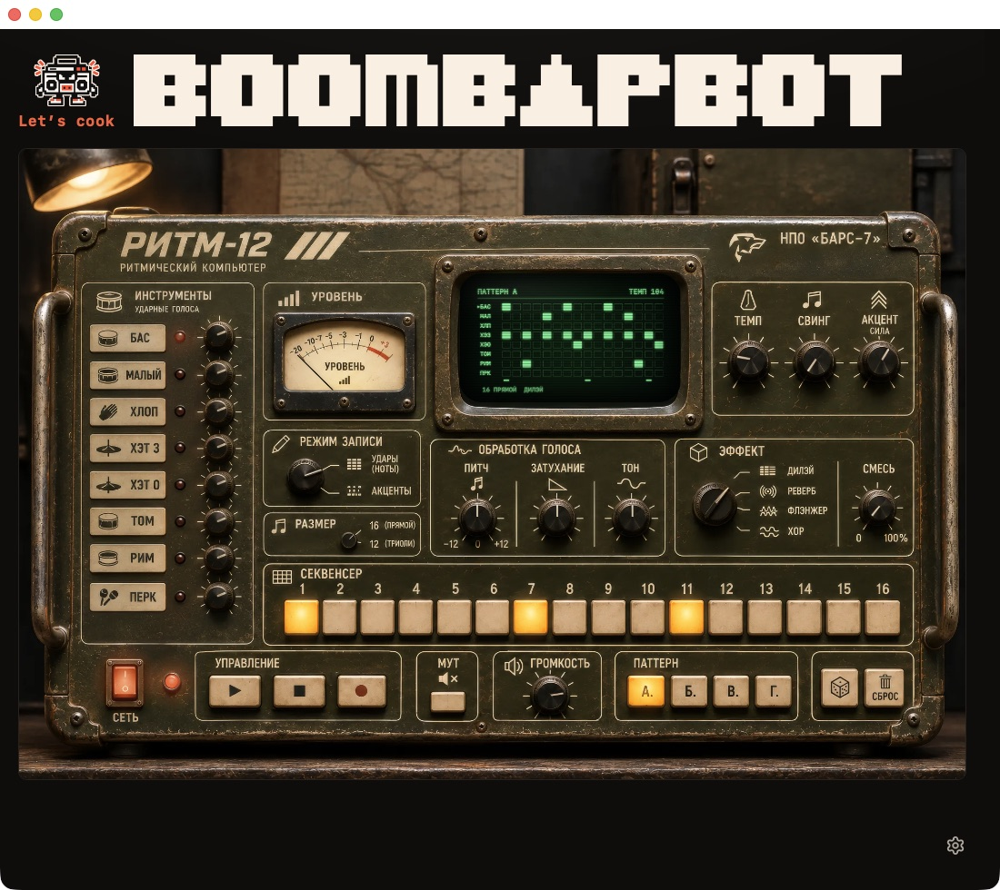

# boombapbot on a desktop

The shared editor with РИТМ-12 in a Tauri window, for macOS first. Unlike
the phone app, its sound is not the web view's: the C++ engine is built
natively, linked into the app, and played through a CPAL output stream. It
is shown under its icon as "boombapbot", with the identifier
`com.boombapbot.desktop`. This is the first slice: the machine, its
settings, its exports and a draft kept by the web view. It is not signed and
not ready to hand to anyone.



## What is here

The page, in `src/`:

- `main.tsx` mounts `BoombapbotEditor` with РИТМ-12, as the site and the
  phone app do, and hands it two things of its own: `audio`, a
  `NativeAudioController` over the bridge below, and `save`. Served to a
  browser (`pnpm dev`) it hands in neither, and is the editor as the site
  has it.
- `tauri-engine.ts` is the bridge the editor asks a native shell for
  (`NativeEngineBridge`): `open`, `send`, `listen` and `close`, as three
  Tauri commands and one event.
- `save-export.ts` is where an export goes. A web view inside an app
  ignores a download, so the app asks where to keep the file and writes it
  there. The page names the file and sends its bytes; it never names a
  place on the disk.

The app, in `src-tauri/`:

- `build.rs` builds the engine with the repository's own CMake
  (`engine/CMakeLists.txt`) for РИТМ-12, as the static library
  `boombapbot_engine_ritm12`, always optimised, and links it.
- `src/ffi.rs` is the engine's C ABI as far as the app calls it.
- `src/messages.rs` is what crosses to the page and back, in the editor's
  spelling (`packages/editor/src/engine/messages.ts`).
- `src/engine.rs` is the engine split as its threading contract splits it:
  an `Engine` for control calls and a `Renderer` for the audio thread.
- `src/output.rs` opens the default output device with CPAL and makes an
  engine at its rate. The stream's callback is `Renderer::fill`.
- `src/bridge.rs` is the control thread, and `src/watch.rs` what it tells
  the page: every measure begun, a position when it changes, the level
  thirty times a second while it changes and the stats ten times a second,
  which is how often the page's own worklet reports.
- `src/save.rs` asks where to keep an export and writes it.
- `src/check.rs`, with the page's `src/check.ts`, is the run that checks
  itself, below. The check itself is the editor's (`runShellCheck`), the
  one the phone app runs too.

Three threads touch the engine, and each has one job. The sound device's
callback renders, and does nothing else: it allocates nothing, takes no
lock, and leaves a peak in an atomic for the others to read. The control
thread makes every other call to the engine: Tauri runs each command on a
thread of its own, so a command hands its request over and waits for the
answer. And sounds are synthesised by the engine itself, on the control
thread, at the device's rate (`snare_engine_synth_sound`): the page sends
a sound's knobs, never samples.

When the default output device changes, CPAL moves the stream to the new
one and says so. If the new device runs at another rate, or the stream
cannot go on at all, the app drops the stream and its engine, makes both
again at the new rate, and reports `ready`. It keeps no copy of the beat:
the page tells the new engine everything again, which makes its sounds at
the new rate, and to play on if it was playing.

The page still loads the WebAssembly engine, for exports: a WAV renders in
a Worker on the page and a MIDI file is made there, as on the site.

Accounts, saved beats, the shop and the upgrade are left out on purpose, as
in the phone app, and so are the footer's pages. Nothing in the app talks to
a server.

## Running it

You need Rust 1.85 or newer and Xcode's command line tools, besides what
the repository already needs. `pnpm install` brings the Tauri CLI. At the
repository root, once the engine is built (`pnpm build:wasm`):

```bash
pnpm prepare:assets
```

```bash
pnpm --filter @boombapbot/desktop app
```

That runs the app from a dev server on port 4341. The first build compiles
Tauri and takes a few minutes. To build `boombapbot.app`, into
`src-tauri/target/release/bundle/macos/`:

```bash
pnpm --filter @boombapbot/desktop bundle
```

Checks:

```bash
pnpm --filter @boombapbot/desktop test:engine
```

```bash
pnpm --filter @boombapbot/desktop check:run
```

- `test:engine` is `cargo test`. It needs no sound device and makes no
  sound.
- `check:run` builds the app and runs it with `BOOMBAPBOT_DESKTOP_CHECK`
  set. The page presses Space, as a person would, and the starter beat
  plays for three seconds through the default output device, so it makes
  sound. Then the page stops it and exports a WAV, a MIDI file and a project
  file through the settings sheet. Nobody is there to be asked where to keep
  them, so in a check run they go to `boombapbot-desktop-check` in the
  system's temporary folder. The app prints one line of JSON, what the page
  saw and what the engine did, and exits with 0 only if neither side's peak
  was silent. With `BOOMBAPBOT_DESKTOP_CHECK=reopen` it also makes the
  engine again halfway, as a change of device does, and listens for three
  seconds more.
- `pnpm typecheck` and `pnpm test:unit` at the root cover the page with the
  rest, and so does CI. CI does not build the app or run `cargo test`.

## What has been checked

On a MacBook Pro (M1 Max) with macOS 26.6.2, Rust 1.94, Tauri 2.12.7 and
CPAL 0.18.2, on 2026-11-18, playing through the Mac's own speakers at
48 kHz.

`test:engine`: 9 tests pass. The engine linked into the app answers with the
ABI version the bindings were written for, and each struct is the size the
header gives it. Every command and report reads and writes in the editor's
spelling. Filling buffers of 1 to 5000 frames, for one, two and six
channels, in float and in sixteen-bit, went to the heap not once on the
Rust side (the engine's own render is held to that by its `test_realtime`),
and the buffers held a beat. The reports come as the worklet's do.

`check:run`, as a debug build, from the dev server, and as the release
`.app`, each with the same result:

- The window shows the machine: the picture panel 1041 by 694 in a window
  1100 wide, all eight of its images loaded, 65 controls. The picture above
  is that window.
- Space starts the beat. The app opened "MacBook Pro Speakers" at 48 kHz,
  stereo, float, in buffers of 256 frames. All eight sounds were made by
  the engine and acknowledged. In three seconds the page was shown every
  step from 1 to 16.
- The engine's own stats say the output was not silent: a peak of 0.66,
  read by the app from the engine's buffers and by the page from the stats
  sent to it, about 146,000 frames rendered in the three seconds, and no
  buffer the device reported as late. The web engine peaks at 0.66 on the
  same beat in the phone app.
- With `reopen`: the engine was made again, the page told it the beat
  again (sixteen sounds sent and acknowledged in all), and the beat played
  on from its first step with the same peak.
- Space stops it, and the engine says it has stopped.
- The exports were written through the app: a WAV of 610,658 bytes, which
  is one measure of 101,769 frames in 24-bit stereo with its header, a MIDI
  file of 218 bytes and a project file of 3,024.

`cargo clippy --all-targets` has nothing to say.

## What has not been checked

- **Nobody has listened to it.** The check runs played through the Mac's
  speakers with nobody asked to listen. Everything above about its sound is
  numbers.
- **A real change of sound device.** Headphones were not plugged in or
  pulled out, no other interface was chosen and no rate was changed in
  Audio MIDI Setup. `reopen` makes the app behave as if the device had said
  its stream cannot go on, which runs the making-again and the telling-again
  but not macOS's part, and not a second rate: the engine has only been
  made at 48 kHz in the app.
- **The dialog that asks where to keep an export** has never been on a
  screen, and nobody has chosen a place in it. In a check run the file's
  place is decided without asking. Everything after that, the bytes crossing
  to the app and being written, is what the check runs.
- **Import.** It opens the system's file chooser, which was not tried.
- **Playing it by hand.** No key or knob was pressed with a mouse. The check
  presses Space and the settings sheet's buttons from inside the page.
- **How long a tap takes to sound**, a knob turned while the beat plays,
  recording by tapping, and long playing.
- **Another Mac, an Intel Mac, Windows.** It has run on one machine.
- **A narrow window.** Under 900px wide the editor shows the phone's panel.
  That was not looked at here.

## What is not right yet

- **The draft is in the web view's storage**, kept by macOS under the app's
  identifier. I do not know whether macOS ever clears it. The phone app
  keeps its draft in the device's own store for that reason.
- **The window opens at one size**, 1100 by 980, which is the machine and
  the settings button with nothing to scroll on this Mac. It does not
  remember where it was or how large.
- **The brand** is the site's header with its link switched off.
- **The icon** is the phone app's stand-in.
- **Not signed.** Another Mac will refuse to open it without a warning. It
  needs an Apple developer team and a Developer ID certificate, and
  notarising.
- **No menu of its own**, and nothing checks for a newer version.
- **The check lives in the app.** `BOOMBAPBOT_DESKTOP_CHECK` works in a
  release build too. Without it the check's commands refuse.
