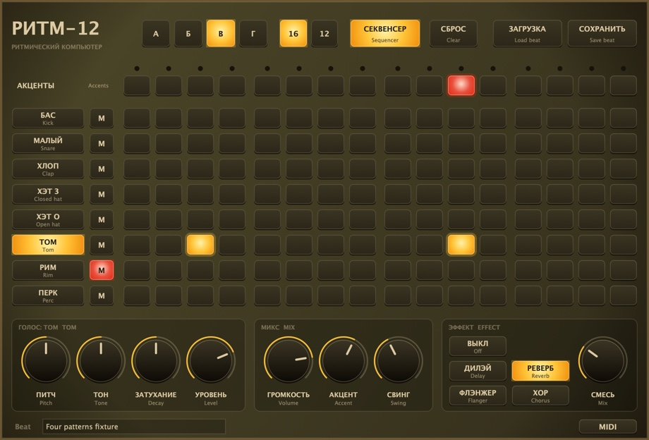

# boombapbot VST3 instrument

The first slices of boombapbot as a plugin: РИТМ-12's eight voices, played
from MIDI notes or from the patterns of a beat saved from the site, in time
with the host, with the machine's knobs as host parameters. It is a JUCE 8.0.9
VST3 instrument on the same engine the site, the phone apps and the desktop
app play through (`engine/`, built natively for
`packages/machine-ritm12`).



It is not a product build yet. See [Licensing](#licensing) before giving a
build to anyone, and [Not verified](#not-verified) for what nobody has checked.

## What it does

- An instrument with MIDI input and one stereo output. No audio input, no MIDI
  output.
- A note-on on any channel plays one hit of the voice that listens to it. The
  notes are the General MIDI ones in
  `packages/machine-ritm12/data/ritm12.machine.json`, which the editor's MIDI
  export writes too, so a file exported from the site plays the right voices.

  | Note | FL Studio calls it | Voice | Panel |
  | --- | --- | --- | --- |
  | 36 | C3 | Kick | БАС |
  | 37 | C#3 | Rim | РИМ |
  | 38 | D3 | Snare | МАЛЫЙ |
  | 39 | D#3 | Clap | ХЛОП |
  | 42 | F#3 | Closed hat | ХЭТ З |
  | 45 | A3 | Tom | ТОМ |
  | 46 | A#3 | Open hat | ХЭТ О |
  | 56 | G#4 | Perc | ПЕРК |

  The perc voice is on 56, General MIDI's cowbell: that is where the machine's
  own file puts it. FL Studio numbers note 36 as C3; hosts that call middle C
  "C4" call the same note C2. Every other note, note-offs and all other MIDI
  messages are ignored.
- The machine has two loudnesses, a plain hit and an accented one, so velocity
  picks one: 104 and above is an accented hit. That is halfway between the
  velocities the editor's MIDI export writes (81 and 127) with the accent knob
  where a new project has it. The Accent parameter sets how far a plain hit
  sits below an accented one; the threshold stays at 104 wherever it stands.
- Hits land on the note's sample offset inside the block. The engine applies
  queued triggers at the start of a render call, so `processBlock` splits the
  block at each note-on and renders the pieces in turn.
- A closed hat cuts a ringing open hat, as on the machine: the two share a
  choke group.
- 47 host-automatable parameters (`AudioProcessorValueTreeState`), all from 0
  to 1 like the machine's knobs unless the table says otherwise, resting where
  a new project has them:

  | Parameter | Ids | At rest |
  | --- | --- | --- |
  | Pitch, Tone, Decay for each voice | `kick_pitch`, `kick_tone`, `kick_decay`, … | 0.5 |
  | Level for each voice | `kick_level`, … | 0.75 |
  | Volume | `master_volume` | 0.8 |
  | Effect: Off, Delay, Reverb, Flanger, Chorus | `effect_kind` | Delay |
  | Effect Mix | `effect_mix` | 0 |
  | Mute for each voice, on or off | `kick_mute`, … | off |
  | Accent | `accent` | 0.6 |
  | Swing | `swing` | 0 |
  | Pattern: А, Б, В, Г | `pattern` | А |
  | Sequencer, on or off | `sequencer` | on |

  The voice ids are `kick`, `snare`, `clap`, `closed_hat`, `open_hat`, `tom`,
  `rim` and `perc`. As on the machine, an effect with its mix at 0 is no
  effect, so a new instance is dry. Level and volume follow the machine's
  arithmetic (`src/document/machine.ts`): a level of 0 is silence, and volume
  is the knob to the power 1.5.
- **A beat saved from the site plays in the host.** The load key
  (ЗАГРУЗКА) on the panel takes the `.boombapbot.json` file the site's project export
  writes. Its four patterns are held by the plugin, and its knobs, levels,
  mutes, accent, swing, effect and the pattern its panel was on become the
  parameter values. Its tempo is not taken: in a host, the host keeps time. A
  file that is not a РИТМ-12 beat changes nothing and the window says why; a
  beat of the earlier machine has to be opened on the site and saved again.
- **A beat made in the host goes back to the site.** The save key (СОХРАНИТЬ)
  writes the plugin as a `.boombapbot.json` the site's import opens: the four
  patterns, every knob, the mutes, the measure, the pattern and voice the
  panel is on, and the host's tempo as a whole number. Each save is a new beat
  to the site, with an id and a date of its own, under the name in the
  panel's name field. Knob positions are written to six places. The
  document has no "no effect", so a beat whose effect is Off is written as the
  delay with none of it mixed in.
- **A pattern goes into the host as MIDI.** The MIDI key at the foot of the
  panel writes the pattern the panel is on as a Standard MIDI File, one
  measure long, with the engine's own exporter, the one behind the site's MIDI
  export. A click saves it; a drag carries it out of the window, onto a track
  of the host or the desktop. Its notes are the voices' own, so the file
  plays this plugin. Accented steps are written at velocity 127 and plain
  ones at the accent knob's gain, as the site writes them, except that a plain
  hit is never written at 104 or more: played back into the plugin it has to
  stay plain.
- **The sequencer follows the host's transport.** While the host plays and
  Sequencer is on, the chosen pattern loops in step with the host's position,
  so it starts in the right place from anywhere in the song and goes back when
  the host loops. A measure is four of the host's beats, counted from the
  start of its timeline: sixteen sixteenths, or twelve triplet eighths if the
  beat was saved that way. Swing delays every second sixteenth as the engine
  does. A pattern chosen while another plays takes over at the next bar line.
  When the host stops, so does the pattern, and hits already sounding ring
  out. Notes from the host play on top at any time. The steps are timed by the
  plugin from the host's position and played as single hits; the engine's own
  sequencer, which counts from where it was started, is not used.
- State: every parameter and the held beat's patterns, saved as one small
  versioned XML element
  (`<BoombapbotPluginState schemaVersion="2" machine="ritm12" kick_pitch="0.5" …>`
  with a `<Beat>` of four `<Pattern>` rows inside). A state that is cut short,
  is not this plugin's, is for another machine or comes from a newer version
  is left unread. In one that is read, a value out of range is brought into
  it, a parameter it does not name goes to its resting value, and a version 1
  state, which has no patterns, loads with none.
- **The window is the machine's painted panel**, the one the site, the phone
  app and the desktop app show, as a page in a web view, with a bar under it.
  "The window" below says how it is put together. It opens at 960 by 684 and
  can be dragged from 0.7 to 2 times that, keeping its shape; the size it was
  left at is saved with the plugin.
  - *On the picture.* The step keys, the voice keys (which play the voice),
    the pattern keys А Б В Г, hits and accents, mute, the dice, clear, the
    measure's size, the voice knobs, the levels, volume, accent, swing, the
    effect and its mix, each moving the plugin and each moved by it. A lamp
    runs over the step the sequencer is playing, and the meter reads how loud
    the plugin is. Play and stop are the sequencer's switch: the patterns
    play while the host does.
  - *What the host keeps.* The tempo knob shows the host's tempo and cannot be
    turned. The record key and the power switch take no hand: a host does the
    recording, and the machine is on for as long as its window is open.
  - *The bar.* The beat's name, which can be typed over: it names the beat in
    the host's project, the file a save suggests and the beat inside that
    file. A line that says what a load or a save did, or why not. And four
    keys: undo, load a beat, save a beat, and the shown pattern as MIDI, which
    a click saves. A drag is meant to carry it out of the window, and in FL
    Studio it does not yet: see "Not verified".
  - *Undo.* The host's undo does not reach the patterns, so the plugin has its
    own. A step key, a clear, a throw of the dice, a new measure size and
    loading a beat are each one step back, 64 at the most. It does not undo a
    knob; the host's undo does that. There is no redo, and the history is not
    saved with the project.
  - *A knob turned* reaches the host as one gesture from the hand taking hold
    to its letting go, which is how a host records automation by touch.
  - A pattern can be written with no beat loaded. Steps written or cleared
    here are saved with the host's project like the rest of the state.
- **The panel drawn here** is the window the plugin had first, and a build
  with `-DBOOMBAPBOT_VST3_WEB_PANEL=OFF` still has it: a panel drawn in code in
  the picture's colours, laid out at 920 by 624, with the same keys and knobs
  and the same bar. It needs no web view and no page. It stays until the
  painted window has been lived with; then it can go.
- The delay keeps time with the host: its echo is a dotted eighth note at the
  host's tempo, read from the playhead at every block and held within the
  engine's 40 to 300. A host that reports no tempo gets 104, the tempo of a new
  project. The delay glides to a new time rather than jumping, and the tail the
  plugin reports grows as the tempo slows.

### Threads

The engine's contract is that the audio thread renders and does nothing else
that could wait: no allocation, no locks. The plugin keeps to it this way.

- **Pitch, tone and decay** change the samples a voice plays, and synthesising
  them allocates. A thread of the plugin's own reads those parameters every
  15 ms and, when one has moved, synthesises the voice
  (`snare_engine_synth_sound`) and hands it to the engine, which takes it at
  the next buffer boundary. Hits already ringing finish on the old samples.
  It polls rather than being woken because a parameter listener can be called
  on the audio thread, where waking a thread is not allowed.
- **Level, volume, the effect and the tempo** are engine commands. The audio
  thread reads the parameters' atomics and the host's playhead at the start of
  each block and queues what has changed, along with the note triggers. The engine's command queue has one
  producer, and once the plugin is playing that is the audio thread alone.
- **The sequencer** runs on the audio thread: at each block it reads the host's
  position, works out which steps fall inside the block and queues their hits
  at their frames, merged in order with the host's notes. It remembers the
  step that comes next while the host plays on, and finds its place afresh
  when the host has jumped. The patterns are plain atomics, written a row at a
  time when a beat or a state is loaded and read without a lock. Reading a
  beat file happens on the thread that asked for it, never the audio thread.
- **An offline render** (`isNonRealtime()`) has no deadline, so `processBlock`
  brings the sounds up to date itself before it renders a block. A bounce
  therefore plays the knobs exactly as they stand at each block, and the same
  bounce twice gives the same samples.
- The engine is created in `prepareToPlay` at the host's sample rate, with
  every sound synthesised at that rate, and replaced if the rate changes.
  Outside the engine's 8 kHz to 192 kHz the plugin stays silent.

## Build

From the repository root, with CMake 3.22 or later, Ninja, and pnpm with the
repository's packages installed:

```sh
pnpm install
cmake -S plugins/vst3 -B build/vst3 -G Ninja -DCMAKE_BUILD_TYPE=Release
cmake --build build/vst3
ctest --test-dir build/vst3 --output-on-failure
```

The window's page is built by the build itself, with pnpm, each time, and
packed into the plugin; the plugin is only linked again when the page has
changed. It needs no Emscripten: the plugin has the engine itself, so its page
carries none. Two options change this:

- `-DBOOMBAPBOT_VST3_BUILD_PAGE=OFF` packs `plugins/vst3/web/dist` as it was
  last built, for a machine that has the page and not pnpm.
- `-DBOOMBAPBOT_VST3_WEB_PANEL=OFF` builds the panel drawn here in place of
  the painted one. That build needs neither pnpm nor a web view.

JUCE is fetched at configure time (`FetchContent`, tag 8.0.9) and is not
vendored. To build against a checkout you already have, add
`-DFETCHCONTENT_SOURCE_DIR_JUCE=/path/to/JUCE`.

The bundle is written to
`build/vst3/boombapbot_plugin_artefacts/Release/VST3/boombapbot.vst3`. The
build never copies it into a system plugin folder
(`COPY_PLUGIN_AFTER_BUILD FALSE`).

On macOS the build is universal, arm64 and x86_64, unless
`-DCMAKE_OSX_ARCHITECTURES=` says otherwise. FL Studio still runs under
Rosetta on Apple silicon, and an arm64-only build of the earlier spike made it
crash as it loaded the plugin.

JUCE signs the bundle and then writes `moduleinfo.json` into it, which leaves
the signature not matching the bundle. So the build signs it once more, ad
hoc, as its last step, and checks the result with
`codesign --verify --deep --strict`. An ad hoc signature loads on the Mac that
built it. It is not a Developer ID and the bundle is not notarised.

`-DBOOMBAPBOT_VST3_BUILD_TESTS=OFF` leaves the tests out.

### Trying it in a host

Copy the bundle into your own plugin folder and sign the copy again, since a
copy can pick up attributes that the signature does not cover. The second line
removes a bundle of the same name first, such as the earlier spike's: copying
over one would leave a mixture of the two.

```sh
mkdir -p ~/Library/Audio/Plug-Ins/VST3
rm -rf ~/Library/Audio/Plug-Ins/VST3/boombapbot.vst3
cp -R build/vst3/boombapbot_plugin_artefacts/Release/VST3/boombapbot.vst3 ~/Library/Audio/Plug-Ins/VST3/
codesign --force --deep --sign - ~/Library/Audio/Plug-Ins/VST3/boombapbot.vst3
codesign --verify --deep --strict --verbose=2 ~/Library/Audio/Plug-Ins/VST3/boombapbot.vst3
```

Then scan for plugins in the host. It is listed as "boombapbot", an instrument.

**FL Studio and a build it has seen before.** FL keeps what it learned about a
plugin, its class ID included, in its plugin database, and a rescan does not
always replace it. If a bundle of the same name with another class ID was
ever scanned (the earlier 808 spike was), FL asks the new bundle for the old
class, finds nothing, and crashes as the plugin is added, with an access
violation on the main thread. With FL closed, in
`<FL user data>/Presets/Plugin database/Installed`, delete
`Generators/VST3/boombapbot.nfo` and `boombapbot.fst`, the `boombapbot` line
of `VerifiedIDs.nfo` and the `[Generators/VST3/boombapbot]` section of
`.Plugins.ini`, then scan again with "Verify plugins" on. This happened on
2026-11-22 and that cleared it.

## The window

The painted panel is a page in JUCE's web view (WKWebView on macOS).

- **The page** (`plugins/vst3/web`) mounts the machine's own `Panel` from
  `packages/machine-ritm12` in the shared editor's runtime, as the desktop
  app does, with the plugin's bar under it and nothing else: no header, no
  settings, no account. It is asked for the picture at any width, since a
  plugin's window is never a phone. The picture and the bar are both sized
  from the window's width, so the whole window scales as one.
- **It is served from inside the plugin.** The built page is packed into one
  zip and compiled into the binary; the web view's resource provider reads
  files out of it. Nothing comes from the network and there is no server.
- **The beat crosses whole.** In an app the page owns the beat and tells the
  engine everything. In a plugin the host owns it, as parameters and state. So
  the page sends its project document when a control changes it, and the
  plugin makes itself that beat, telling the host of each parameter that
  moved. The plugin sends its own when a host's automation or a recalled
  project changes it, and the page takes it without an undo step. Neither is
  sent its own change back, and the page is sent back whatever the plugin did
  not take, which is how the tempo knob returns to the host's tempo.
- **Of the engine's commands only three cross:** a voice key's hit, and play
  and stop, which in a host are the sequencer's switch. The host keeps the
  tempo and the transport. Back the other way come the step the sequencer is
  on and how loud the output is, 30 times a second while they change.
- **The bar's keys ask the plugin.** Loading, saving and the MIDI file are
  done by the plugin (`Source/BeatDesk`), with the system's own dialogs, and
  the bar is told in words how each went. The panel drawn here uses the same
  code.
- **A knob held** is told to the plugin when the hand takes hold and when it
  lets go, and the plugin marks the gesture on each parameter that moved in
  between.
- **The three controls the host keeps** are made inert by the page after the
  panel is drawn, by their names on the panel. The panel itself is not
  changed for the plugin.

Measured on the owner's Mac on 2026-11-22:

| | Painted panel in a web view | Panel drawn here |
| --- | --- | --- |
| Bundle | 23 MB | 17 MB |
| Window to page ready, arm64 | about 0.5 s | not measured |
| Window to page ready, x86_64 under Rosetta | 0.7 to 0.9 s | not measured |
| CTest | 14 of 14 | 10 of 10 |

On Windows the web view would need Microsoft's WebView2: its SDK at build
time, `NEEDS_WEBVIEW2 TRUE` in `juce_add_plugin`, and the WebView2 runtime on
the user's machine, which Windows 11 has and Windows 10 usually does. On Linux
it would need WebKitGTK. Neither has been built.

## Tests

`ctest` runs these. The first is the processor self-test
(`Tests/ProcessorSelfTest.cpp`), a console program that links the code the
plugin is made of and drives its `AudioProcessor` as a host would, without the
VST3 wrapper. At 44.1, 48 and 96 kHz, in blocks of 64 and 512 frames where
block size matters, it checks:

- no MIDI gives exact silence;
- a hit starts on its note's sample offset, two notes in one block each start
  on theirs, and the same notes render the same samples whatever the block
  size;
- every mapped note sounds, on any channel, and all 120 other notes, note-offs
  and velocity 0 give exact silence;
- velocity 104 is where the accent starts, and nothing else depends on
  velocity;
- a closed hat cuts an open hat;
- each of the 32 voice knobs alters its voice, a level of 0 silences it, and
  the kick's knobs leave the snare alone;
- a knob turned before `prepareToPlay` and one turned after come to the same
  samples, and a knob turned between two hits changes the second;
- volume scales the output as the machine's knob does and 0 is silence;
- each effect alters the output, no two effects sound the same, and an effect
  with no mix, or Off with some, leaves the output as it was;
- the delay's first echo lands a dotted eighth after the hit at host tempos of
  60, 120 and 174 and at 104 with no host clock; a clock with no tempo or a
  nonsense one is the same as none; a tempo outside 40 to 300 is held at the
  nearer end; the tempo changes nothing while no effect is mixed in; and the
  tempo jumping about while the delay rings keeps the output in range;
- the audio thread at work: 3000 realtime blocks with notes on every voice, a
  SysEx message, the sequencer, a host that starts, stops, loops and changes
  tempo, and knobs turning between blocks, while a second thread works the
  panel (steps, dice, undo, measure size, voice keys, the name) and saves and
  recalls the plugin's state. The test program replaces `new` and `delete`,
  and on macOS `malloc`, `calloc`, `realloc` and `free` as its own code calls
  them, and counts every call the thread inside `processBlock` makes. The trap
  first has to count a block it takes itself, and an offline block that
  re-synthesises a sound, which is allowed the heap. The realtime blocks must
  make none;
- a host that misbehaves: 1008 blocks of every size from 0 to 8192 frames, at
  positions from minus infinity to 1e300 beats and tempos from nothing to
  infinity, with notes dated before and long after the block, all give sound
  in range and come back, and the plugin plays in time afterwards. A position
  more than a thousand million beats from the start of the timeline is taken
  as a host that is not playing. This test found a hang: such a position
  overflowed on its way to a step number;
- on a realtime clock the plugin's own thread makes the new sound, and it is
  heard without the audio thread synthesising anything;
- the accent knob and the mutes do what the machine's do;
- the sequencer against the engine's own: for three patterns and swings and a
  triplet beat, two measures on a playing host render the same samples as the
  same plugin played by notes on the frames the engine's sequencer logs for
  that pattern, in blocks of 64 and of 512;
- the sequencer picks the pattern up mid-measure when started at beat 21.25,
  plays the measure before beat 0, loses and doubles no hit when the host's
  position is a hair off at every block, goes back when the host loops, and
  changes pattern at the bar line; a stopped host, no host clock, Sequencer
  off or no beat loaded each give silence;
- the panel: a press and a drag on the step keys, by mouse events made for the
  test, write the steps they should, and the pattern written plays the same
  samples as that beat loaded from a file; the pattern, effect, measure, mute
  and clear keys do what they say; a voice's key plays it and hands it the
  knobs; the sequencer reports the step it is on; steps and voices the machine
  does not have are turned down;
- saving a beat: the site's fixture written out and read back is the same
  beat; a plugin worked by hand saves what was done to it, and that file
  loaded into a new plugin plays the same samples; and the file the plugin
  writes for the fixture is byte for byte
  `packages/machine-ritm12/fixtures/saved-by-plugin.project.json`, which the
  site's own unit tests (`plugin-beat.test.ts`) open with the site's reader
  and compare with the fixture, so the two sides cannot drift apart unseen;
- the name field: a name typed there names the beat, the saved file and the
  beat in it; one too long for the site is cut to 80 letters; it and the voice
  the panel is on come back with the host's project; wiped out, the beat is
  untitled again;
- a pattern as MIDI: the file is a two-track MIDI file at the beat's tempo
  with a note for each hit, on the voices' notes on channel 10 at the two
  velocities; its notes played back into the plugin render the same samples
  as the sequencer playing the pattern; swing writes every second sixteenth
  late and a twelve-step measure is written in triplets;
- the window's size: it opens at the panel's own, shows the same panel
  through a scale when made larger, and comes back at the size it was left,
  after closing and after a recall from the plugin's state;
- the dice and the undo: over 4000 throws the dice hit each kind of step as
  often as the site's do and touch no other voice; undo walks back through 64
  changes; a clear, a throw, a new measure size, a drag on the step keys and
  loading a beat are each one step back, checked against the plugin's saved
  state byte for byte;
- beat files: the fixture `four-patterns.project.json` loads and sets the
  parameters; twelve kinds of file that are not a beat are refused with a
  reason and change nothing; the beat survives save → load → save byte for
  byte and plays the same; a version 1 state still loads;
- a sample rate change, an unsupported rate, the parameter count, the tail and
  that the window opens;
- state: it is versioned, save → load → save is byte for byte the same with
  every knob somewhere awkward, the recalled plugin renders the same samples,
  eight kinds of bad state leave it untouched, and a state of ours that holds
  nonsense is brought into range;
- the plugin's voice table against `ritm12.machine.json`.

The self-test's window is the panel drawn here, whichever window the build
gives a host: that panel's code is in every build, and so are its tests.

A second program (`Tests/WindowSnapshot.cpp`) paints the panel drawn here to
`build/vst3/window.png` with a beat loaded and fails if the picture is blank:

```sh
build/vst3/boombapbot_window_snapshot panel.png path/to/a.boombapbot.json
```

A third (`Tests/WebPanelCheck.cpp`, in a build with the painted window, on
macOS) opens that window with no host, in a real window on the desktop, and
works the page through the web view, as arm64 and again under Rosetta:

- the page loads from inside the plugin and says so, the picture is drawn and
  fills the window's width at three to two, and the bar lies under it and ends
  where the window does;
- the page opens on the plugin's beat; a voice key, a step key and a knob on
  the page move the plugin and the tom's key is heard; a parameter and a step
  changed in the plugin show on the page; both sides then rest;
- stop and play turn the sequencer off and on;
- a name typed in the bar names the plugin's beat, and a name set in the
  plugin shows in the bar;
- a step written on the page is taken back by the bar's undo, in the plugin
  and on the page;
- the page's meter is given how loud the plugin is;
- a hold on a knob reaches the host as one gesture around its changes, with
  the last change sent before the hand lets go, and a change with no hold is
  a gesture by itself;
- the tempo knob, the record key and the power switch are inert, and a tempo
  turned anyway goes back to the host's;
- saving a beat writes a file the beat reader takes, loading one puts it on
  the page, a file that is not a beat is refused in words, and the pattern is
  written as a MIDI file, each by the code the bar's keys call;
- the window opens at its own size and, left a quarter larger, opens a
  quarter larger.

To look at it, `BOOMBAPBOT_HOLD_WINDOW=5` keeps the window up that many
seconds at the end.

### Steinberg's validator

Steinberg's own VST3 validator runs against the built bundle, with its
extensive tests, natively and under Rosetta. It is not built unless asked for,
because it means fetching Steinberg's VST3 SDK (3.8.1, MIT licensed, used only
to build the validator and no part of the plugin):

```sh
cmake -S plugins/vst3 -B build/vst3 -G Ninja -DCMAKE_BUILD_TYPE=Release \
  -DBOOMBAPBOT_VST3_STEINBERG_VALIDATOR=ON
cmake --build build/vst3
ctest --test-dir build/vst3 -R steinberg --output-on-failure
```

All 537 of its tests pass on each architecture. The first run found one
failure: the plugin's one program had no name. It is now called "Default".
The validator checks that the plugin keeps to the VST3 interfaces (buses,
parameters, state, processing at many rates and block sizes, threading of its
calls). It does not listen, and it does not open the window.

### Sanitizers

`-DBOOMBAPBOT_VST3_SANITIZE=` builds everything, JUCE and the engine included,
under clang's sanitizers. The heap trap is left out of such a build, since a
sanitizer has the allocator to itself, and the busy realtime blocks above run
without it: they are what the thread sanitizer is there to watch.

```sh
cmake -S plugins/vst3 -B build/vst3-asan -G Ninja -DCMAKE_BUILD_TYPE=Debug \
  -DCMAKE_OSX_ARCHITECTURES=arm64 -DBOOMBAPBOT_VST3_SANITIZE=address,undefined
cmake --build build/vst3-asan --target boombapbot_plugin_selftest
build/vst3-asan/boombapbot_plugin_selftest

cmake -S plugins/vst3 -B build/vst3-tsan -G Ninja -DCMAKE_BUILD_TYPE=RelWithDebInfo \
  -DCMAKE_OSX_ARCHITECTURES=arm64 -DBOOMBAPBOT_VST3_SANITIZE=thread
cmake --build build/vst3-tsan --target boombapbot_plugin_selftest
build/vst3-tsan/boombapbot_plugin_selftest
```

A Debug build also switches on JUCE's own assertions, which print
`JUCE Assertion failure` and carry on. CI does not run these builds.

On macOS the rest check the built bundle:

- its signature (`codesign --verify --deep --strict`) and that it holds both
  architectures (`lipo -verify_arch`);
- that a process can load the binary and get a plugin factory from it
  (`Tests/BundleLoadCheck.cpp`);
- the plugin through its VST3 wrapper, in JUCE's own VST3 host
  (`Tests/BundleHostCheck.cpp`): the bundle scans as one instrument called
  boombapbot with no input and a stereo output, the host sees the 47
  parameters by name, it is silent without MIDI, note 36 plays the kick, a
  parameter the host sets reaches the sound, a second instance recalls the
  first one's state, and the delay follows the tempo the host reports. It is
  then opens the plugin's window as a host does, the VST3 view in a real
  window on the desktop, shown, resized and closed (not on a CI runner). It is
  also handed a state with the fixture beat in it, which a program made of
  the plugin's own code writes first (`Tests/StateWriter.cpp`), wrapped as
  JUCE's host keeps a VST3 state: the beat's knobs are recalled, and with the
  host playing and no notes the pattern sounds, its first hit on the frame of
  its third step, and stays silent with the host stopped. So the host's
  position reaches the sequencer through the wrapper.

On Apple silicon with Rosetta installed, the self-test, the load check and the
hosted check each run a second time as x86_64, which is how FL Studio runs the
plugin.

## Verified

On the owner's Mac (Apple silicon, macOS 26, Xcode's clang, CMake 4.4.3) on
2026-11-22:

- A configure and a Release build from an empty build directory, with JUCE
  8.0.9 from a local checkout.
- Steinberg's validator from VST3 SDK 3.8.1, extensive tests: 537 of 537 pass
  on arm64 and on x86_64 under Rosetta.
- The binary holds both architectures (`lipo -archs`: `x86_64 arm64`).
- The bundle's signature verifies after the build, `moduleinfo.json` included
  (`codesign --verify --deep --strict`: valid on disk, satisfies its
  designated requirement).
- All fourteen CTest tests pass: the self-test's 516 checks as arm64 and again
  as x86_64 under Rosetta, the snapshot of the panel drawn here, the painted
  window opened and worked on both, the signature, the architectures, the
  load check on both, the hosted check on both and Steinberg's validator on
  both.
- A build with `-DBOOMBAPBOT_VST3_WEB_PANEL=OFF`, the panel drawn here as the
  window, passes its ten.
- `/usr/bin/python3` loads the binary with `ctypes.CDLL` and gets a factory
  from `GetPluginFactory`, as arm64 and as x86_64.

- The self-test under sanitizers, arm64 only: a Debug build under the address
  and undefined-behaviour sanitizers and a build under the thread sanitizer
  each pass every check with nothing reported, and the Debug build prints no
  JUCE assertion.

GitHub's macOS 26 runner does the same build and runs the same tests, fetching
JUCE itself (the `vst3` job in `.github/workflows/native.yml`). All fourteen
pass there too, the check that opens the painted window among them.

**In FL Studio 2026 (26.1.7, under Rosetta), by the owner on 2026-11-22**, with
the build of the hang fix, whose window was the panel drawn here:

- the plugin scans and loads, and the panel shows at its right shape;
- notes from the piano roll and from a keyboard play the eight voices;
- a parameter linked to a hardware controller (Kick Level) follows it;
- a beat exported from the site loads, and its pattern plays in time with
  FL's transport in pattern mode, at 99 and at 100;
- the step keys, the dice and the undo work while it plays;
- a project saved and reopened brings the plugin back as it was;
- a beat saved from the plugin opens on the site;
- the window resizes;
- the MIDI key dragged onto the Channel Rack imports the shown pattern. FL's
  playlist does not take it; see below.

The owner also tried the painted window in FL Studio that day: first the
picture alone with no bar, which worked, and then the window as it is now.
With the bar:

- the beat's name can be typed, and FL's own shortcuts do not fire while it
  is;
- undo, load and save work;
- a click on the MIDI key saves the shown pattern, and the `.mid` is right.

Dragging the MIDI key out of the window did not work; see below.

## Not verified

- **Dragging the MIDI key out of the painted window does not work.** The
  owner tried it in FL Studio on 2026-11-22 and nothing was carried out. The
  page tells the plugin when the key is dragged and the plugin asks the
  system to start a drag, which needs the mouse button still down; why that
  does not take, from a web view, has not been looked into. It is a known
  gap and the owner is not asking for it now. A click on the key saves the
  file, which then goes onto FL's Channel Rack from the Finder. The panel
  drawn here drags.
- **The rest of the painted window in a host.** In FL Studio nobody has
  watched its meter or recorded a knob as automation, and whether a click in
  the web view keeps FL's shortcuts from it afterwards, until FL's window is
  clicked again, is not known. No other host has opened it.
- **Several painted windows at once,** each with a web view and its
  processes, and how the page looks on a screen that is not Retina.
- **Other hosts.** FL Studio has run it (see above). No other host has loaded
  it.
- **MIDI into FL Studio.** A drag from the MIDI key onto FL's playlist shows
  FL's paintbrush and drops nothing, and the saved `.mid` dragged from the
  Finder does the same: the playlist is not where FL takes a MIDI file. The
  Channel Rack is. The MIDI key dragged straight onto it imports the pattern,
  and so does the saved `.mid` from the Finder. Other hosts are untried.
- **A closed hat that may go missing.** In one session the owner sometimes did
  not hear the hat on the fifteenth step of a looping pattern. It was not
  pinned down.
- **`pluginval` has not run.** Steinberg's validator has, and passes (see
  "Steinberg's validator" under the tests), but it is one host's view.
  `pluginval` drives a plugin harder and in other orders.
- **Locks on the audio thread.** The self-test traps heap use there and finds
  none, and the thread sanitizer finds no race, but nothing traps a lock, a
  system call or a page fault. What a system library allocates inside itself
  is not seen either. That the audio thread takes no lock is by design and by
  reading. The sanitizers have run the self-test only, never the plugin in a
  host, and never the x86_64 half.
- **The tests and the keys with a chooser.** The load, save and MIDI keys open
  a file chooser, which no test can press; the tests go through the code the
  keys call. In FL Studio the owner has used the load and save keys of the
  panel drawn here.
- **The sequencer in song mode and odd signatures.** In FL Studio it has
  followed the transport in pattern mode at two tempos. Song mode, tempo
  automation and a signature other than 4/4 are untried there. Where a step
  falls exactly halfway between two frames, the plugin and the engine's own
  sequencer can land it one frame apart.
- **How it sounds.** The tests compare samples. The owner has played it in FL
  Studio and raised nothing but the hat above. A knob turned while its voice
  rings changes the next hit, not the ringing one, and nobody has judged how
  that feels under automation.
- **Windows and Linux.** It has only ever been built on macOS, and CI builds
  it there alone. The painted window needs WebView2 on Windows and WebKitGTK
  on Linux, which the CMake project does not yet ask for. The bundle checks
  and the check of the painted window are macOS only.
- **An Intel Mac, and any macOS older than 26.** The x86_64 half has only run
  under Rosetta. The deployment target is 11.0 and untried.
- **Distribution:** no Developer ID signature, no notarisation, no installer.

## Next slices

- **Take the panel drawn here out,** once the painted window has been lived
  with: `Source/Panel`, `Source/PluginEditor`, the snapshot test and the
  option that chooses between the two.
- **The paid effects.** The upgrade's six effects are in the engine, and
  neither the page nor the plugin's Effect parameter names them yet.
- **Beats from an account.** Only a file on disk can be loaded. Beats saved to
  a boombapbot account are out of reach.
- **Time signatures and tempo changes inside a block.** A measure is four
  beats whatever the host's signature says, and the tempo is read once a
  block.
- **Other formats and platforms:** AU, CLAP, Windows and Linux builds.

## Licensing

JUCE 8 is offered under the AGPLv3 or a commercial licence from its makers,
and a plugin built with it can only be given to anyone else under one of the
two. The owner chose on 2026-11-22: the commercial licence, on its free
Starter tier. The reason is the upgrade: its paid effects are to be gated in
the plugin too, and under the AGPLv3 anyone may rebuild the plugin without the
gate.

What the licence says, in JUCE 8's (https://juce.com/legal/juce-8-licence/)
and, clause for clause, in JUCE 9's:

- Clause 1.9 lets the owner of a product distribute and sell it, on any tier.
  Nothing asks for the product's source.
- Clause 1.2.1 sets the Starter tier's limit at 20,000 dollars over the last
  twelve months. For a person it counts what their use of JUCE brings in,
  from every source; for a company it counts everything the company and its
  affiliates receive, JUCE or not. Above it a paid tier is needed, or
  distributing stops (1.14). The upgrade unlocks the plugin along with the
  rest, so its sales are best counted whole.
- Clause 2.3 forbids putting JUCE under an open source licence, so the plugin
  cannot be given one that reaches JUCE. The repository can stay public: it
  has no licence, and it does not hold JUCE, which the build fetches (1.17
  forbids handing JUCE on by itself).

Not done yet, so builds are still for the machine that made them and CI still
throws its build away:

- The VST3 SDK that JUCE 8.0.9 bundles is 3.7.12, offered under the GPLv3 or
  Steinberg's own agreement. Without the GPL, that agreement has to be signed
  with Steinberg, or JUCE moved to a version that bundles the MIT-licensed
  SDK 3.8.
- Nothing else. The owner sells as a person, with no company formed, so the
  limit that applies is the first: what the use of JUCE brings in. Forming a
  company would change that to everything the company receives.
